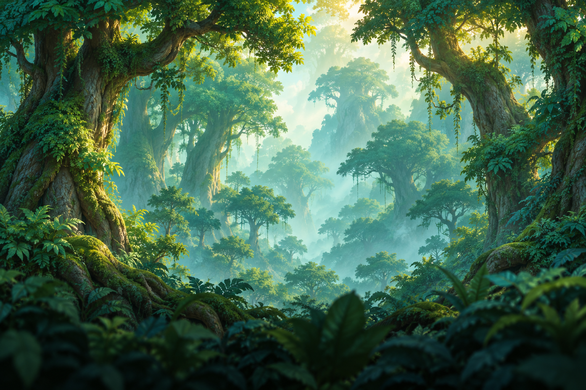

# Super Diego · Juego Diego

Juego de plataformas **2D HD** para **Android y Windows**, con ocho mundos previstos y niveles rejugables.

La versión **0.5.1** estrena el nombre **Super Diego** y un icono original con el protagonista, sus gafas y el Bosque Esmeralda. Conserva las partidas y ajustes de Salto Heroes cuando se instala como actualización con la misma firma. [Diseño del icono y compatibilidad](docs/IDENTIDAD_VISUAL.md).

La versión **0.5.2** permite que Terrón y Moflete bajen de estructuras al perseguir, presenta energía, llaves, hojas y cristales con **iconos y cantidades**, aumenta el impulso del salto a **680 px/s** y sincroniza la cámara vertical con Diego. [Cambios y validación](docs/PULIDO_0.5.2.md).

La versión **0.5.3** anima los miembros de los enemigos: brazos y manos de Moflete y Remiendo, apoyos y raíces según su anatomía, ala de Plumín y aleteo armónico de Nóctilo con flexión de puntas. Terrón y Moflete lo utilizan en el bosque; los otros cinco se pueden revisar en el visor de animación y conservan pendiente su IA de nivel. [Animación y pruebas](docs/ANIMACION_ENEMIGOS.md).

## Bosque Esmeralda 1-1 · versión 0.5.3

El primer bosque se amplía a **19 tramos y tres rutas de llaves**, con **81 enemigos**: 41 Terrones y 40 Mofletes. Todos detectan, avisan y persiguen a Diego. Desde 0.5.2, los 38 que nacen en plataformas también pueden bajar a terreno inferior durante la persecución; las patrullas tranquilas respetan los bordes. Se conservan pisotones y lanzamientos.

El recorrido combina terrazas, barrancos, ocho puentes, ocho troncos móviles y 19 pasos de dos dianas. Las rutas posteriores cambian el orden y las alturas, e incluyen viajes diagonales. Los 21 faroles recuperan energía al activarse. Piñas y apoyos permiten volver a intentar cada reto; los pasos resueltos permanecen abiertos durante el intento.

Las llaves están separadas en las tres rutas. La duración prevista de **18–22 minutos** es una estimación de autoría, pendiente de medir con el público objetivo. No hay un reloj que retrase la salida y los secretos son opcionales. [Recorrido, recuperación y límites de validación](docs/BOSQUE_ESMERALDA.md).

Para completar cada intento hay que recoger **tres llaves de ramas** y abrir la puerta del bosque. El HUD y los tres cerrojos muestran el progreso; volver al farol conserva las llaves y reiniciar las repone. [Diseños temáticos y reglas de las llaves](docs/LLAVES_Y_PUERTAS.md).

Diego mantiene sus movimientos, 14 estados de animación y controles por gestos sin botones fijos. Los enemigos se eliminan saltando encima y reciben impactos de objetos lanzados. La meta guarda el resultado y permite rejugar para mejorar tiempo y coleccionables. Desde Pausa puedes volver al entrenamiento anterior, con los seis objetos, o regresar al bosque.



[Diseño del nivel, recorrido y controles](docs/BOSQUE_ESMERALDA.md).

## Descargar el APK e instalarlo

1. Abre [Actions → Validar y generar APK Android](https://github.com/RamonC5/juegoDiego/actions/workflows/validate.yml) y entra en la ejecución verde del commit más reciente.
2. Descarga el artefacto `super-diego-android-<número>`, descomprime el ZIP y abre `super-diego.apk` en el móvil Android ARM64.
3. Si Android lo solicita, permite instalar aplicaciones desde el navegador o gestor de archivos utilizado.

El APK es una compilación de pruebas firmada, con versión y commit en `build-info.json`, y se conserva durante 30 días. La CI comprueba su firma, paquete y arquitectura. Las capturas de la escena real se descargan en `bosque-esmeralda-capturas-<número>`. Las claves y binarios no se incluyen en Git.

## Jugar y abrir el proyecto

- **Táctil:** arrastra horizontalmente en la mitad de movimiento; desliza hacia arriba en la otra mitad para saltar, hacia abajo y mantén para agacharte, y toca brevemente para coger o lanzar. Admite varios dedos a la vez.
- **Teclado:** A/D o flechas, Espacio, S/flecha abajo, E y Escape. También admite mando.
- **Pausa:** sensibilidad, lados intercambiables, salto completo, carrera, guías y teclas reasignables. Foco visible y textos de energía y coleccionables.

Importa `project.godot` con **Godot 4.7.2 estándar** y pulsa F5. Usa GDScript tipado, renderizador Compatibility, vista base 1280×720, orientación horizontal y física a 60 Hz. Los perfiles de exportación son Android ARM64 y Windows x86_64.

## Verificación

```sh
godot --headless --path . --editor --import --quit
godot --headless --path . --quit-after 3
godot --headless --fixed-fps 60 --path . --script tools/tests/test_player.gd
godot --headless --fixed-fps 60 --path . --script tools/tests/test_throwables.gd
godot --headless --fixed-fps 60 --path . --script tools/tests/test_forest.gd
godot --headless --fixed-fps 60 --path . --script tools/tests/test_bridges.gd
godot --headless --fixed-fps 60 --path . --script tools/tests/test_moving_platforms.gd
godot --headless --fixed-fps 60 --path . --script tools/tests/test_forest_expansion.gd
godot --headless --fixed-fps 60 --path . --script tools/tests/test_forest_route.gd
godot --headless --fixed-fps 60 --path . --script tools/tests/test_gameplay_polish.gd
godot --headless --fixed-fps 60 --path . --script tools/tests/test_enemy_motion.gd
```

La validación 0.5.1 reunía **474 comprobaciones**; 0.5.2 añade y actualiza las regresiones de persecución, salto y HUD. La base anterior incluía: 88 de protagonista, 63 de objetos, 61 de bosque, 55 de puentes, 27 de troncos, 105 de ampliación/persecución, 70 de ruta continua y cinco de los datos binarios extraídos del APK. Instala el APK ARM64 en emulador Android API 35 y conserva capturas y auditoría.

Las suites antiguas de mecanismos usan un fixture estable; las nuevas cargan el bosque completo. La ruta geométrica continua usa controles y lanzamientos reales y excluye la colisión enemiga para aislar geometría; el combate se prueba aparte. Su tiempo simulado no mide una primera partida del público objetivo. `capture_forest.gd` captura móvil, tablet, panorámico y viaje diagonal. El tacto, el objetivo de 60 FPS y la duración con un niño de 10 años requieren comprobación física.

## Estructura y documentación

| Ruta | Contenido |
| --- | --- |
| `game/boot/` | Composición del nivel y base del entrenamiento, pausa y opciones |
| `game/features/levels/` | Construcción del bosque, terreno, coleccionables y fondo |
| `game/features/enemies/` | Percepción, persecución, bordes y contratos de combate |
| `game/features/player/` | Diego, animaciones, entrada y entrenamiento |
| `game/features/objects/` | Seis arrojadizos y sus definiciones |
| `game/core/services/` | Ajustes y progreso local separado |
| `game/data/worlds/world_01/level_01.tres` | Datos del primer nivel; quedan reservados los otros mundos |
| `game/assets/` | Recursos finales usados por el juego |
| `art/` | Conceptos, fichas, prompts y revisión; excluidos del APK |

- [Arquitectura](docs/ARQUITECTURA.md).
- [Desarrollo y exportación Android](docs/DESARROLLO.md).
- [Catálogo de personajes](docs/PERSONAJES.md).
- [Protagonista y animaciones](docs/PROTAGONISTA.md).
- [Gestos táctiles](docs/CONTROLES_TACTILES.md).
- [Objetos arrojadizos](docs/OBJETOS_ARROJADIZOS.md).
- [Skill de personajes](.agents/skills/generar-personajes-salto-heroes/SKILL.md).
- [Diseño de dinámicas y progresión](docs/DINAMICAS.md).
- [Troncos viajeros: segunda dinámica del nivel 1](docs/dinamicas/troncos_viajeros.md).
- [Skill de dinámicas](.agents/skills/crear-dinamicas-salto-heroes/SKILL.md).

Los otros cinco enemigos tienen animación visual en el visor, incluido [Nóctilo, el murciélago volador](art/characters/noctilo/ficha.md); su integración jugable sigue pendiente. Los siete reutilizan sus PNG mediante malla 2D articulada; no son hojas de fotogramas nuevas. Los otros niveles, mundos, jefes y audio quedan para entregas posteriores.


### Música y reintentos · 0.6.0

Bosque Esmeralda incluye música instrumental original en bucle y volumen ajustable desde pausa. Los enemigos derrotados desde el último farol reaparecen al morir; se conservan llaves, coleccionables y mecanismos. La partida usa iconos y números, con las instrucciones escritas en pausa. Contratos y procedencia en [Arquitectura](docs/ARQUITECTURA.md#música-por-nivel-reaparición-y-señales-visuales--060).
