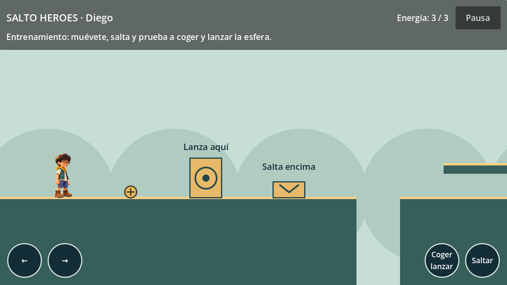
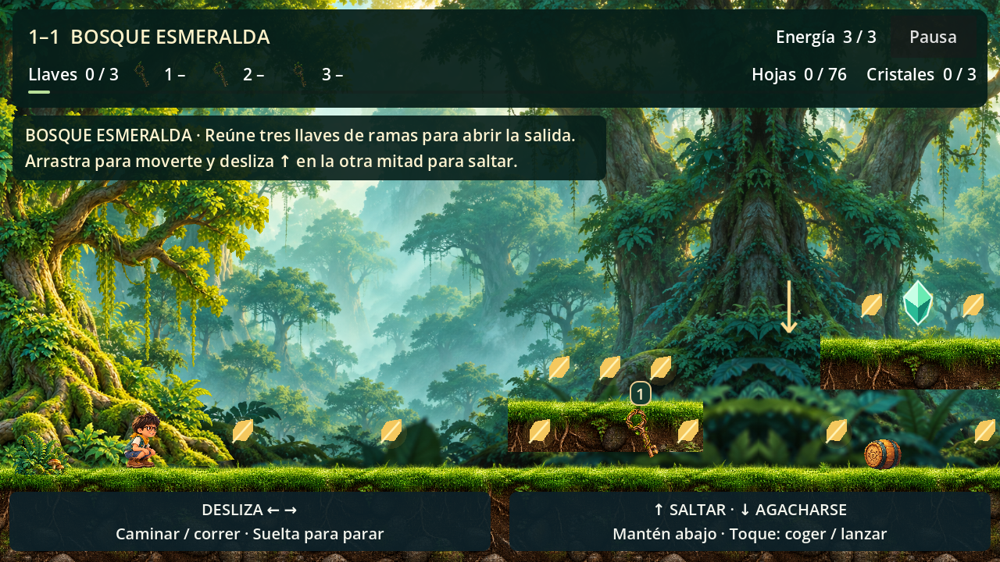
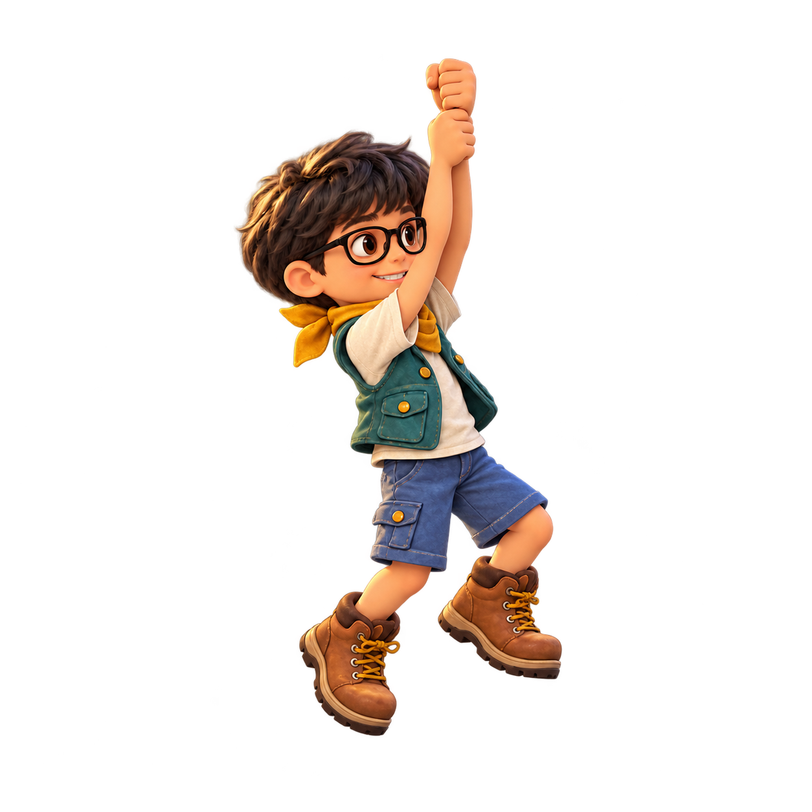

# Diego · protagonista 2D

Desde el 17 de octubre de 2026 da nombre al juego **Super Diego**. Su retrato y vestuario existentes sirven de referencia para el [icono original de la aplicación](../../../docs/IDENTIDAD_VISUAL.md); sus sprites y su identidad jugable se mantienen.

**ID:** `diego` · **Rol:** protagonista compartido entre mundos · **Revisión:** 001 · **Fecha:** 15 de octubre de 2026.

Nombre y vestuario propuestos. La referencia del usuario determina la identidad visual; esta adaptación queda disponible para su valoración.

## Identidad

Se conservan el pelo oscuro con flequillo, las gafas negras grandes, la sonrisa y la expresión amable del niño de la fotografía. El acabado raster texturizado, el sombreado suave y los materiales de tela y cuero comparten la dirección visual de los enemigos. La vista lateral deja visible parte del rostro y mantiene la luz desde arriba a la izquierda.

El vestuario propone camiseta marfil, chaleco corto verde azulado, pañuelo mostaza, pantalón corto azul y botas marrones. La silueta humana erguida, las gafas, las manos visibles y el gesto decidido le dan una identidad propia dentro del reparto. No se asignan mundo, historia ni poderes nuevos.

## Movimiento y actuación

Camina, acelera, corre, frena, se agacha, salta con altura variable, cae y aterriza. El salto admite una pequeña tolerancia al salir de un borde y al pulsar antes de tocar el suelo. Al pisar desde arriba un objetivo válido, rebota; el ascenso y el contacto lateral no producen un pisotón.

Puede recoger un objeto cercano con una pulsación, transportarlo y lanzarlo con otra. El objeto existe como entidad física independiente; se suelta en el fotograma 2 de `throw`, una sola vez. Incluye reacción al daño, derrota sentada y celebración. La protección temporal se muestra con un aro continuo, sin parpadeos.

Las velocidades, energía y tiempos son valores iniciales editables, no decisiones de dificultad definitivas. [Movimientos, controles y animaciones](../../../docs/PROTAGONISTA.md).

## Recursos e integración

Once hojas PNG RGBA contienen **48 poses fuente**. `SpriteFrames` expone **14 estados**, incluidos los ciclos de reposo, caminar, correr y transportar, las acciones de recoger/lanzar/daño/derrota/victoria y las poses de salto, caída, aterrizaje y sostener en reposo. La colisión es independiente de la imagen.

La generación no respetó de forma exacta todos los límites de la cuadrícula solicitada. Se usan regiones de atlas explícitas, con pivote de apoyo y escala uniforme por hoja. Un shader suave descarta alfa residual de baja opacidad. Los PNG originales no se han retocado por código; el informe conserva los avisos de margen de las hojas fuente. La referencia está en `art/`; únicamente las once hojas de ejecución se importan desde `game/assets/`.

La integración se ha comprobado en **Godot 4.7.2**, con 88 pruebas de comportamiento y revisión gráfica en Compatibility a 1280 × 720 y 1024 × 768. Quedan pendientes la valoración visual del usuario, la ficha completa de «opción A» y las pruebas físicas y de rendimiento en Android y Windows.

## Registro de producción

- [Encargo y propuestas](brief.yaml).
- [Prompts exactos](prompts.md), generados mediante `image_gen` integrada.
- [Metadatos](character.json), [regiones y pivotes](atlas_layout.json).
- [Revisión visual y funcional](qa.md) e [informe técnico](qa-technical.json).
- [Catorce estados renderizados](preview_animations.png) sobre fondos claros y oscuros.
- [Catálogo del reparto](../../../docs/PERSONAJES.md).

## Agacharse · 16 de octubre de 2026

Cuatro poses nuevas de respiración en postura baja, manteniendo gafas, vestuario y acabado. Desliza abajo y mantén en la mitad de acciones; también S, flecha abajo y mando. El cuerpo baja a 58 px y no se levanta bajo un techo. [Hoja de agacharse](../../../game/assets/textures/characters/diego/crouch_v001.png), [prompt exacto](crouch-prompt.txt).

## Doble salto y pose de agarre · 17 de octubre de 2026

La nueva pose mantiene el rostro, pelo, ropa, luz y proporciones de las hojas anteriores. El juego dibuja la liana por separado y alinea las manos del raster con su nudo, girando alrededor del agarre. Las doce imágenes suman 49 poses y 16 estados; `double_jump` reutiliza las dos poses ascendentes y reinicia el gesto de impulso. La marcha acompaña la velocidad real. [Prompt exacto y parámetros](prompts-movement-2026-10-17.md).
