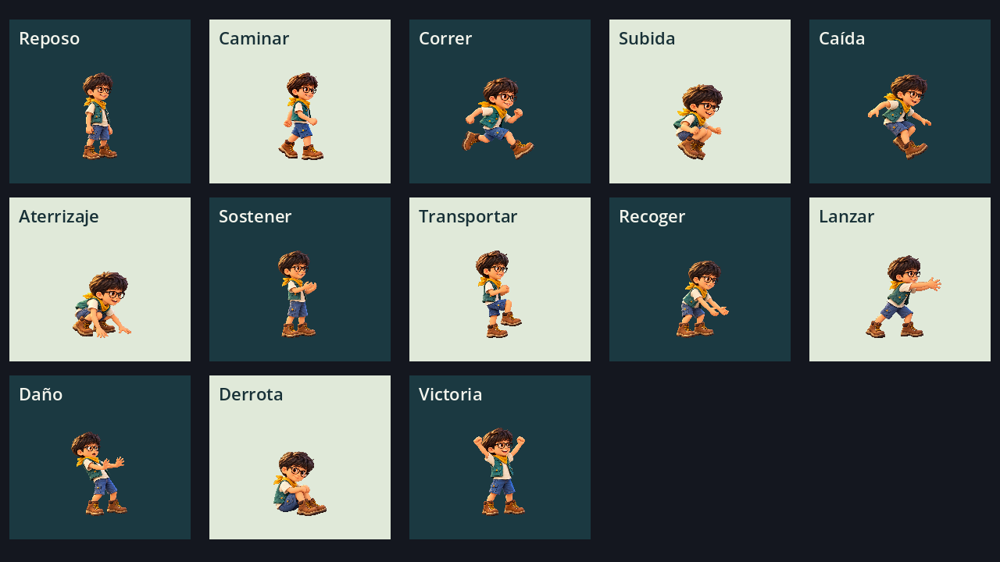

# Revisión de Diego · 15 de octubre de 2026

## Resultado

Propuesta visual integrada y comprobada en Godot 4.7.2. La foto guía el pelo oscuro, las gafas y la expresión; el vestuario de aventura, el nombre de trabajo y las proporciones siguen como propuestas. El personaje comparte texturas y luz con el reparto sin reutilizar la anatomía de sus enemigos.

## Arte y atlas

- Concepto PNG RGBA de 1254 × 1254: pasa el comprobador del skill.
- Diez hojas RGBA: ocho de 1254 × 1254 y dos de 1536 × 1024; 44 poses fuente, 13 estados de ejecución.
- Las hojas generadas conservan píxeles de alfa residual y algunas poses cruzan la cuadrícula ideal. El informe del comprobador original conserva esos avisos; **las hojas fuente no pasan la comprobación estricta de cuadrícula y margen**.
- La integración usa regiones explícitas `AtlasTexture`, margen en un lienzo virtual, pivotes de apoyo, escala uniforme por hoja y `filter_clip`. El shader descarta el alfa de baja opacidad con transición suave. No se han recortado, reescalado ni retocado los PNG por código.
- Las 44 regiones efectivas pasan la comprobación de contenido, margen virtual y apoyo. No hay errores de regiones ni poses vacías. El detalle está en [qa-technical.json](qa-technical.json).
- La revisión renderizada muestra cuerpo y botas completos, gafas legibles, vestuario consistente y poses diferenciadas. Se han revisado estados sobre fondos claros y oscuros. Los ciclos son una primera animación para probar; el ajuste artístico fino y de sensaciones continúa tras la valoración del usuario.

## Motor y comportamiento

Importación y arranque sin errores de scripts en Godot **4.7.2.stable.official.ed1daf0bf**. Se ejecutaron **27 comprobaciones con cero fallos** usando la física y las escenas reales del motor. [Salida de las pruebas](qa-tests.txt).

Cubren apoyo, aceleración, carrera, frenado, altura de salto, salto completo con pulsación, tolerancia al borde y al aterrizaje, rechazo de pisotón al ascender/contactar desde abajo o lateralmente, rebote por sensor, recogida, suelta única, objeto físico independiente, daño, protección, derrota, reaparición, tres contactos simultáneos, liberación al arrastrar, pausa, cambio de lados y reasignación que conserva el mando. Las alturas medidas fueron 36,12 y 107,98 px para salto corto y mantenido.

## Revisión gráfica

Capturas reales del motor con **Compatibility, OpenGL 4.5 y Mesa llvmpipe**, en una pantalla virtual X11. Se comprobó:

- [Entrenamiento a 1280 × 720](preview_gameplay.png): transparencia, escala y lectura del protagonista, HUD y botones.
- [Pausa y ajustes](preview_controls.png): encabezado y acciones fijas, foco visible, casillas con contraste y opciones en una zona desplazable.
- [Formato tablet a 1024 × 768](preview_tablet.png): distribución y botones dentro del área visible.
- [Estados en claro y oscuro](preview_animations.png): recortes, identidad y poses.

Los avisos del entorno sobre `/proc/self/exe` y VSync de la pantalla virtual no son errores del proyecto. La última captura usó audio Dummy porque este entorno no tiene dispositivo de sonido.

## Límites y trabajo posterior

No se certifican todavía dispositivos físicos Android/Windows, lectores de pantalla nativos, tacto real ni 60 FPS. El cálculo RGBA8 de las diez hojas ronda 60 MiB antes de compresión y no mide VRAM de un teléfono. El arte fuente conserva los avisos descritos: su reutilización sin el atlas y shader actuales requiere limpieza de margen/alfa mediante el flujo de imágenes.

Quedan la valoración visual del usuario y la descripción detallada de «opción A». Los ocho mundos, niveles rejugables, enemigos y jefes completos siguen fuera de esta prueba del protagonista. La CI ejecuta las pruebas antes de generar el APK; el estado de cada build se consulta en Actions.
