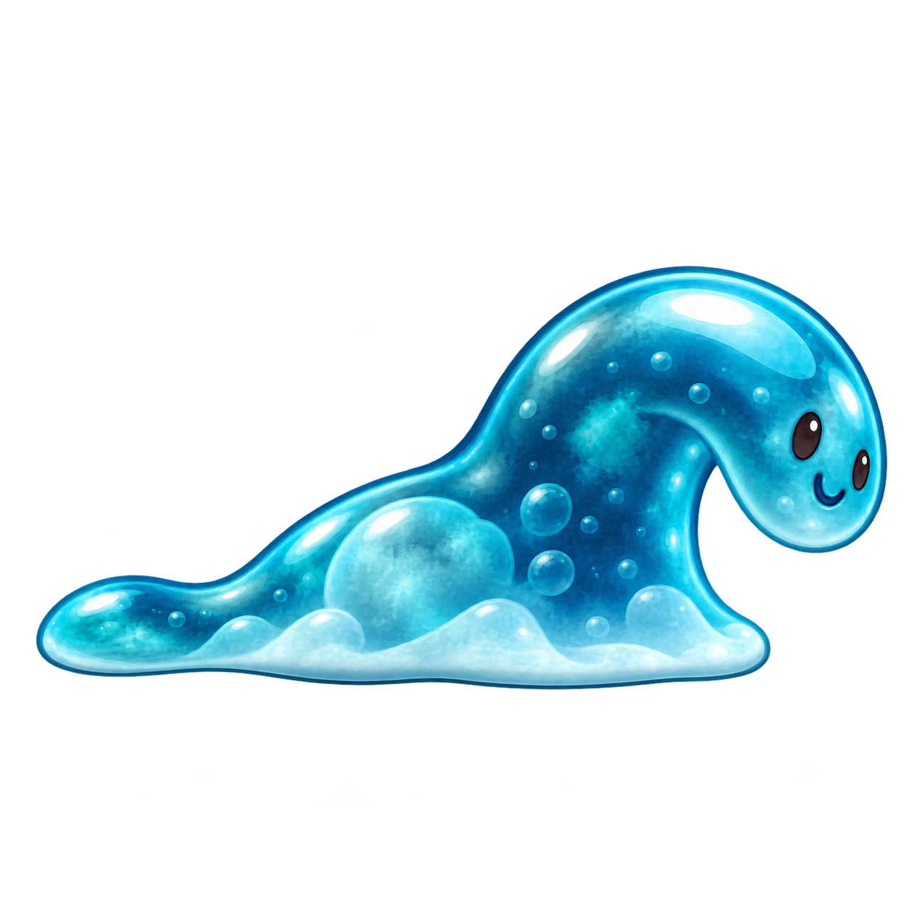

# Goterón · personalidad e identidad visual

**ID:** `goteron` · **Revisión visual:** 004 · **Rol:** enemigo normal eliminable por pisotón.

**Concepto base:** valorado positivamente por el usuario. **Nueva versión visual:** propuesta, pendiente de su valoración. Fecha: 15 de octubre de 2026.

## Personalidad

**Despistado, bonachón, desequilibrado.** Su cuerpo ya ha girado cuando se da cuenta de por dónde iba.

| Rasgo propio | Diseño de esta revisión |
| --- | --- |
| Silueta y proporciones | Base de babosa larga y baja con un cuello blando que sube y se vence hacia delante. |
| Rostro | Dos ojitos oscuros pequeños y desiguales sobre el lado visible del gel, y sonrisa blanda. |
| Postura clave | Cabeza redondeada caída hacia delante; base continua y cola pegada al suelo. |
| Gesto característico propuesto | La parte superior se inclina, se retrasa y rebota suavemente al cambiar de dirección. |
| Concepto y materiales conservados | gel turquesa translúcido, base deslizante sin patas, cola blanda |

La diferencia de identidad se apoya en forma, cara y postura; el acabado y la iluminación siguen perteneciendo al mismo juego. La [versión anterior](concept_v003.png) se conserva.

## Comportamiento propuesto

**Desplazamiento:** Se desliza con un leve vaivén; la cabeza blanda llega tarde a los giros y luego recupera el equilibrio.

**Pisotón:** La cabeza se pliega sobre la base y todo el gel se aplana en una única reacción legible.

En Costa de Coral 2-1 se desliza a 58 px/s por trayectos delimitados, gira en los bordes y causa daño lateral. Diego puede esquivarlo, pisarlo o lanzarle un objeto. El cuello y la cola se deforman con fases distintas en la malla existente.

## Requisitos y estado técnico

Se mantienen 2D, Android y Windows, ocho mundos, niveles rejugables y enemigos normales eliminables por pisotón. Su primera aparición jugable está en `world_02`; conserva el identificador `goteron`. La descripción completa de «opción A» sigue pendiente de incorporarse.

[concept_v004.png](concept_v004.png) es un PNG RGBA de **1254 × 1254 px** con fondo transparente y margen mínimo medido de **18 px**. Se entrega como concepto estático, con vista lateral orientada a la derecha.

Se propone producir después `patrol`, `stomped` y `defeated` en celdas de 256 × 256, con raíz [128, 224] por verificar. Costa de Coral reutiliza el raster y la malla 2D, con un recorte ajustado al gel para alinear el piso y el pisotón. Las hojas de poses dibujadas siguen como propuesta.

## Archivos

- [Encargo y decisiones](brief.yaml).
- [Prompts exactos y versiones](prompts.md).
- [Metadatos y estado de producción](character.json).
- [Revisión visual](qa.md) e [informe técnico](qa-technical.json).

Volver al [catálogo y comparación del reparto](../../../docs/PERSONAJES.md).

## Movimiento articulado · 17 de octubre de 2026

El raster existente tiene animación por malla 2D con perfiles propios de anatomía. Ondula cuello y cola de gel con desfase; conserva su anatomía sin brazos. No hay hojas de fotogramas nuevas.

La animación se puede revisar en `enemy_gallery.tscn` y el combate en `coral_level_01.tscn`. Los sensores permanecen independientes del dibujo. [Contrato, visor y verificación](../../../docs/ANIMACION_ENEMIGOS.md).

### Revisión del movimiento · 0.7.2

El rig conserva el PNG y la anatomía. La marcha sigue la distancia real, los apoyos alternan suelo y arco, las muñecas acompañan al brazo con desplazamientos menores y las rotaciones respetan la proporción del recorte en píxeles. Reposo, frenado, persecución y caída se mezclan sin reiniciar el ciclo; el aleteo conserva su frecuencia común. La suite `test_enemy_motion.gd` supera 198 comprobaciones. La revisión 0.7.2 se publicó cuando solo Terrón y Moflete tenían integración jugable. Pruebas físicas Android/Windows pendientes.
