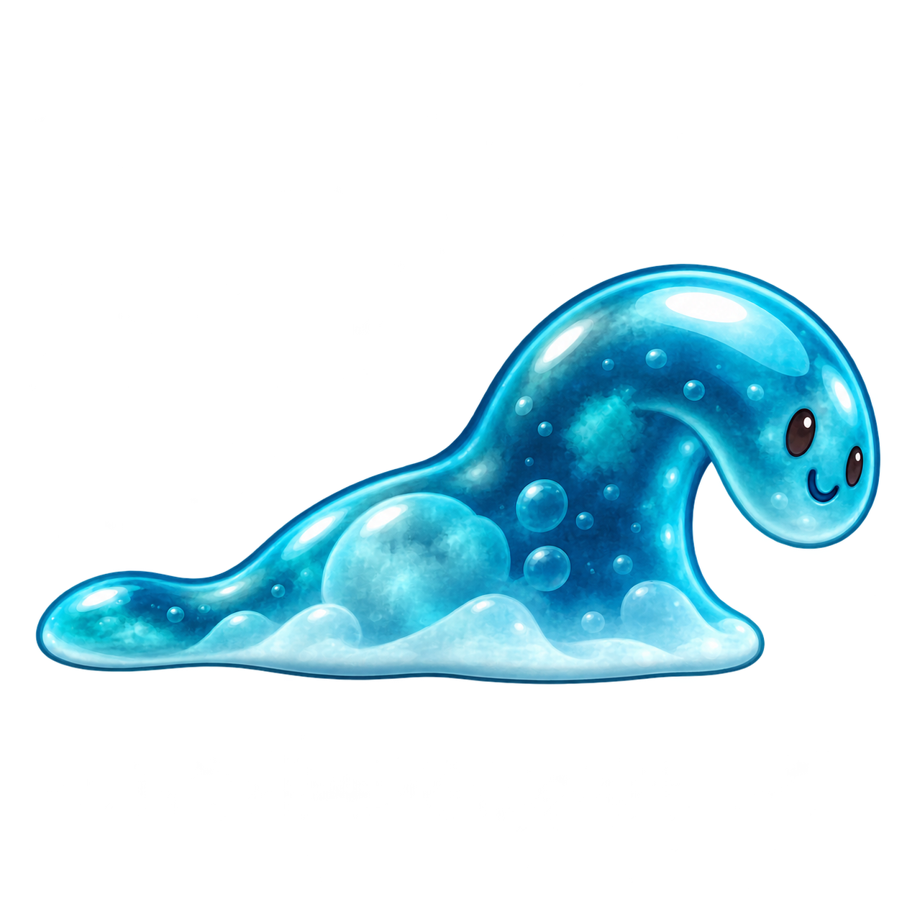

# Goterón · personalidad e identidad visual

**ID:** `goteron` · **Revisión visual:** 004 · **Rol:** enemigo normal eliminable por pisotón.

**Concepto base:** valorado positivamente por el usuario. **Nueva versión visual:** propuesta, pendiente de su valoración. Fecha: 15 de octubre de 2026.

## Personalidad

**Despistado, bonachón, desequilibrado.** Su cuerpo ya ha girado cuando se da cuenta de por dónde iba.

| Rasgo propio | Diseño de esta revisión |
| --- | --- |
| Silueta y proporciones | Base de babosa larga y baja con un cuello blando que sube y se vence hacia delante. |
| Rostro | Dos ojitos oscuros pequeños y desiguales sobre el lado visible del gel, y sonrisa blanda. |
| Postura clave | Cabeza redondeada caída hacia delante; base continua y cola pegada al suelo. |
| Gesto característico propuesto | La parte superior se inclina, se retrasa y rebota suavemente al cambiar de dirección. |
| Concepto y materiales conservados | gel turquesa translúcido, base deslizante sin patas, cola blanda |

La diferencia de identidad se apoya en forma, cara y postura; el acabado y la iluminación siguen perteneciendo al mismo juego. La [versión anterior](concept_v003.png) se conserva.

## Comportamiento propuesto

**Desplazamiento:** Se desliza con un leve vaivén; la cabeza blanda llega tarde a los giros y luego recupera el equilibrio.

**Pisotón:** La cabeza se pliega sobre la base y todo el gel se aplana en una única reacción legible.

Estos gestos y patrones aún no son animaciones ni comportamiento ejecutable. Velocidad, tiempos, contacto lateral y rebote del jugador se ajustarán al implementar las mecánicas. Los sensores y colisiones serán independientes de la imagen.

## Requisitos y estado técnico

Se mantienen 2D, Android y Windows, ocho mundos, niveles rejugables y enemigos normales eliminables por pisotón. El personaje no tiene un mundo asignado; su identificador se conserva para reutilizarlo y mantener la rejugabilidad. La descripción completa de «opción A» sigue pendiente de incorporarse.

[concept_v004.png](concept_v004.png) es un PNG RGBA de **1254 × 1254 px** con fondo transparente y margen mínimo medido de **18 px**. Se entrega como concepto estático, con vista lateral orientada a la derecha.

Se propone producir después `patrol`, `stomped` y `defeated` en celdas de 256 × 256, con raíz [128, 224] por verificar. La preparación de sprites, las animaciones, `SpriteFrames`, la escena de enemigo y la integración jugable quedan pendientes.

## Archivos

- [Encargo y decisiones](brief.yaml).
- [Prompts exactos y versiones](prompts.md).
- [Metadatos y estado de producción](character.json).
- [Revisión visual](qa.md) e [informe técnico](qa-technical.json).

Volver al [catálogo y comparación del reparto](../../../docs/PERSONAJES.md).
