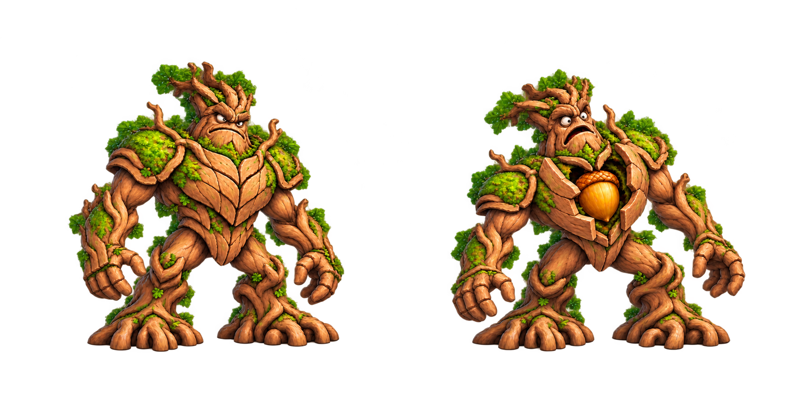

# Nudor · el Roble Furioso

Jefe del Bosque Esmeralda, ID `nudor`.

Concepto raster original, RGBA, 1774 × 887 px, con dos poses. Solo recibe daño de objetos lanzados a la bellota durante la apertura; nunca por pisotón.

[Diseño de combate, arena y animación](../../../docs/jefes/nudor.md).

Estado original del concepto v001: archivado entonces sin integración; véase la integración 0.15.0 más abajo. Se conserva el PNG generado sin retoques. Tiene contenido en los bordes y no supera el margen mínimo de producción; requiere preparar encuadre y poses individuales antes de usar como sprite. No se certifica animación ni escala móvil.

El SVG es un contenedor del PNG original RGBA incrustado, sin redibujado vectorial; se usa para conservar la imagen mediante el conector de archivos de texto. Extraer el PNG antes de producir sprites.

## Integración 0.15.0 · 20-10-2026

Dos poses de producción a partir del concepto, con encuadre ampliado: [PNG RGBA](../../../game/assets/textures/characters/nudor/poses_v001.png).

`NudorVisual` articula hombros, muñecas y raíces sobre malla raster; `NudorBoss` controla avisos, ataques y apertura. [Combate](../../../docs/jefes/nudor.md). Godot headless comprueba combate e integración, sin certificar el movimiento gráfico. El comprobador estricto de margen no pasa por alfa residual tenue; el shader existente lo elimina. [Informe](qa-poses-v001.json). Pendientes revisión gráfica y dispositivos físicos.
