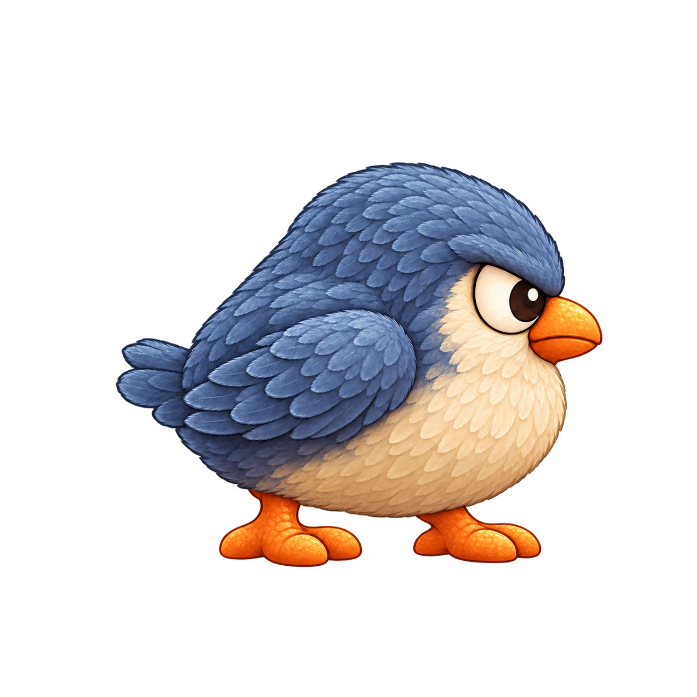

# Plumín · enemigo normal de Salto Heroes

**Identificador:** `plumin` · **Versión visual:** 002 · **Estado:** propuesta de concepto · **Fecha:** 15 de octubre de 2026.

## Identidad visual propuesta

| Rasgo | Diseño |
| --- | --- |
| Concepto | Ave terrestre redondeada |
| Silueta | Cuerpo de pera compacto, cabeza redondeada y dos pies anchos. |
| Materiales | plumas cortas y densas, pico mate, patas lisas |
| Paleta | azul pizarra, marfil cálido, naranja apagado |
| Vista | Lateral hacia la derecha; personaje completo |
| Luz | Suave desde arriba a la izquierda |
| Acabado | Raster 2D HD, texturas legibles y sombreado suave incorporado |
| Referencia de acabado | [Terrón](../terron/ficha.md), conservando una identidad diferente |

Nombre, especie, materiales, aspecto y patrón de movimiento son propuestas originales.

## Función y comportamiento propuestos

Enemigo normal eliminable mediante un pisotón válido, de acuerdo con la regla confirmada del proyecto.

**Movimiento:** Alterna dos pasos cortos con un pequeño salto; ritmo y altura pendientes de ajustar.

**Reacción al pisotón:** Se encoge, pliega las alas y baja la cabeza como señal de derrota.

Los valores de velocidad, recorrido, contacto lateral, rebote del jugador y tiempos de derrota se decidirán durante la implementación. La detección del pisotón y las colisiones serán independientes del dibujo.

## Lectura y requisitos

- Cabeza redondeada sin cresta.
- Pico que marca la dirección.
- Alas plegadas y pies anchos.

La forma y la postura complementan al color para reconocer la zona pisable y la dirección. Se ha revisado su lectura estática a tamaño reducido y sobre fondos claros y oscuros.

La entrega usa una imagen 2D compartible entre Android y Windows. No se asignan mundos ni temáticas: el ID estable podrá reutilizarse al definir los ocho mundos y sus niveles rejugables. La especificación completa de «opción A» sigue pendiente de incorporarse; este concepto conserva los requisitos visuales conocidos sin redefinir esa elección.

## Archivo entregado y producción pendiente

[concept_v002.png](concept_v002.png) es un **PNG RGBA de 1254 × 1254 px**, con transparencia real y margen mínimo medido de **17 px**. Es una imagen de concepto, no una hoja de animación.

| Acción futura | Propuesta | Estado |
| --- | --- | --- |
| `patrol` | 6 fotogramas, 10 FPS, bucle | Pendiente |
| `stomped` | 3 fotogramas, 12 FPS, sin bucle | Pendiente |
| `defeated` | 1 pose final, sin bucle | Pendiente |

Se propone celda de 256 × 256 y raíz [128, 224], pendientes de verificar con las poses reales. La animación, los recursos `SpriteFrames`, la escena y el comportamiento en Godot quedan pendientes.

## Archivos del personaje

- [Encargo y decisiones](brief.yaml).
- [Prompts exactos y referencias](prompts.md).
- [Metadatos y estado de producción](character.json).
- [Informe técnico](qa-technical.json) y [revisión visual](qa.md).

Volver al [catálogo de personajes](../../../docs/PERSONAJES.md).
