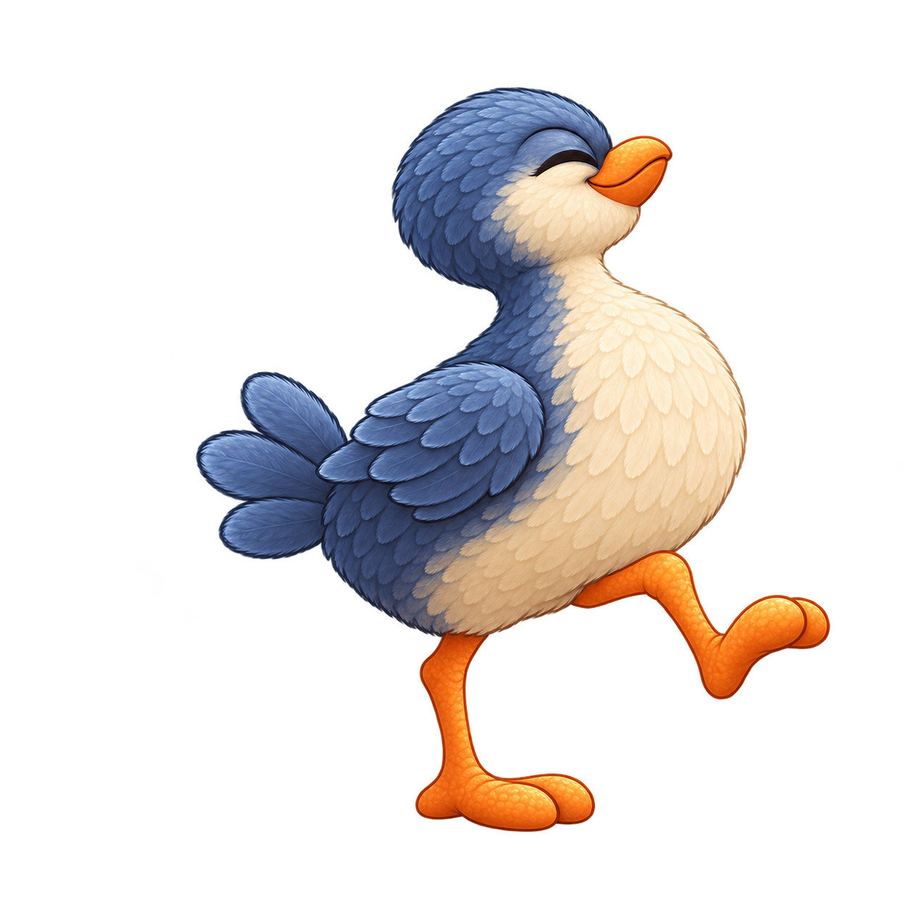

# Plumín · personalidad e identidad visual

**ID:** `plumin` · **Revisión visual:** 003 · **Rol:** enemigo normal eliminable por pisotón.

**Concepto base:** valorado positivamente por el usuario. **Nueva versión visual:** propuesta, pendiente de su valoración. Fecha: 15 de octubre de 2026.

## Personalidad

**Presumido, fanfarrón, teatral.** Se pavonea incluso cuando tiene que dar un rodeo.

| Rasgo propio | Diseño de esta revisión |
| --- | --- |
| Silueta y proporciones | Pecho amplio, cuello visible y dos patas relativamente largas y delgadas. |
| Rostro | Ojo cerrado en arco satisfecho y pico curvo alzado. |
| Postura clave | Pecho hacia delante, una rodilla levantada y ala pequeña apoyada en el costado. |
| Gesto característico propuesto | Alisa una pluma del pecho, levanta el pico y retoma su paso exagerado. |
| Concepto y materiales conservados | plumaje azul pizarra, pecho marfil, pico y patas naranjas |

La diferencia de identidad se apoya en forma, cara y postura; el acabado y la iluminación siguen perteneciendo al mismo juego. La [versión anterior](concept_v002.png) se conserva.

## Comportamiento propuesto

**Desplazamiento:** Se pavonea con pasos altos, posa un instante con el pecho erguido y da un pequeño salto.

**Pisotón:** El pecho se desinfla visualmente, las alas se juntan y la cabeza se agacha.

Estos gestos y patrones aún no son animaciones ni comportamiento ejecutable. Velocidad, tiempos, contacto lateral y rebote del jugador se ajustarán al implementar las mecánicas. Los sensores y colisiones serán independientes de la imagen.

## Requisitos y estado técnico

Se mantienen 2D, Android y Windows, ocho mundos, niveles rejugables y enemigos normales eliminables por pisotón. El personaje no tiene un mundo asignado; su identificador se conserva para reutilizarlo y mantener la rejugabilidad. La descripción completa de «opción A» sigue pendiente de incorporarse.

[concept_v003.png](concept_v003.png) es un PNG RGBA de **1254 × 1254 px** con fondo transparente y margen mínimo medido de **6 px**. Se entrega como concepto estático, con vista lateral orientada a la derecha.

Se propone producir después `patrol`, `stomped` y `defeated` en celdas de 256 × 256, con raíz [128, 224] por verificar. La preparación de sprites, las animaciones, `SpriteFrames`, la escena de enemigo y la integración jugable quedan pendientes.

## Archivos

- [Encargo y decisiones](brief.yaml).
- [Prompts exactos y versiones](prompts.md).
- [Metadatos y estado de producción](character.json).
- [Revisión visual](qa.md) e [informe técnico](qa-technical.json).

Volver al [catálogo y comparación del reparto](../../../docs/PERSONAJES.md).
