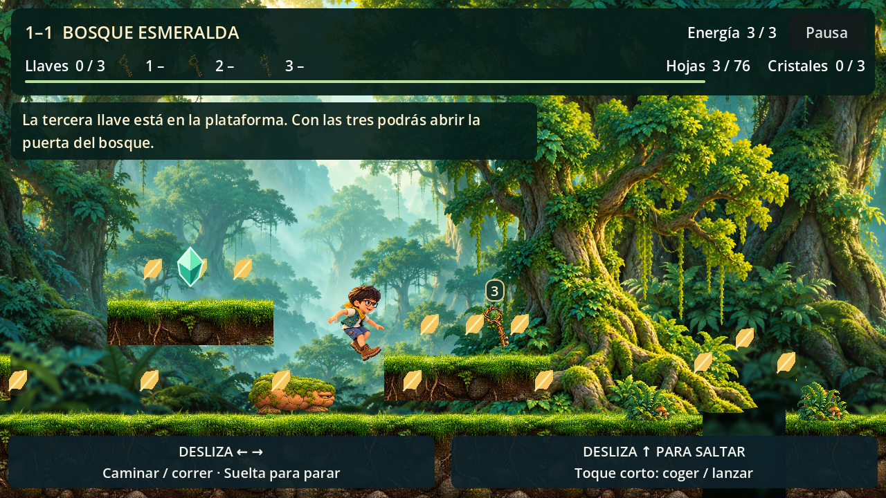
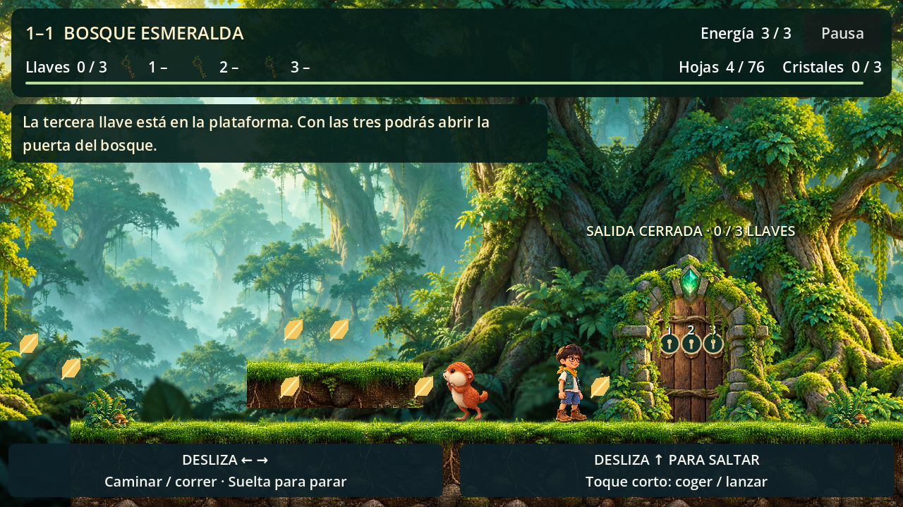

# Revisión de llaves y puerta · 2026-10-16

## Arte

- Generación con la herramienta integrada `image_gen`; prompts y edición exactos en `prompts.json`.
- Ocho familias de llaves y un panel de puerta del bosque, todos PNG RGBA. Solo el bosque se asigna al nivel existente; los otros siete ambientes son propuestas.
- Tres llaves de ramas con uno, dos y tres brotes superiores. La segunda versión conserva las tres figuras completas y separadas; se utilizan regiones explícitas de límites distintos, sin suponer celdas iguales. Los números de recogida añaden una identificación inequívoca.
- Fondos y hojas de autoría conservados sin edición de píxeles. Los atlas se encuadran con regiones normalizadas. El shader descarta alfa residual y conserva el tinte de los iconos pendientes y la animación de apertura.
- Importación limitada a 768 px para el atlas triple y 256 px para cada recurso individual, sin mipmaps. Los originales HD siguen en Git.
- Revisados visualmente los ocho diseños, el panel y las capturas de la escena real; no se detectan dientes recortados en las tres regiones finales.

## Juego y guardado

Godot **4.7.2**, comprobado contra el SHA-512 del proyecto. Importación sin errores. **173 comprobaciones correctas:** 55 de protagonista y controles, 63 de arrojadizos y 55 del bosque y sus llaves.

Las pruebas incluyen recogida física, rechazo de cuerpos ajenos y jugador derrotado, ausencia de duplicados, rechazo de llaves ajenas, bloqueo con cero, una o dos llaves, colisión de puerta cerrada, acceso por salto a las plataformas, conservación al reaparecer, tercera llave durante un recorrido físico completo, guardado y reinicio. La puerta rechaza ranuras duplicadas o inválidas. Una prueba adicional recoge la tercera llave mientras Diego ya permanece en el sensor de salida y verifica la finalización.

## Presentación

Renderizado Compatibility real con OpenGL y llvmpipe. Capturas en 1280×720, tablet 1024×768 y panorámico 1600×720, sin errores de script ni shader. Se revisan legibilidad, proporciones, espacio seguro, marcas del HUD y estados de la puerta.

Las capturas de puerta abierta y cerrada se preparan sobre la escena real activando los eventos de recogida; el comportamiento físico se valida por separado con las pruebas anteriores. Los controles por gestos, la pausa, el foco visible y las manos para arrojadizos se mantienen. La revisión de escritorio no sustituye una prueba de tacto y rendimiento en un dispositivo Android físico.

