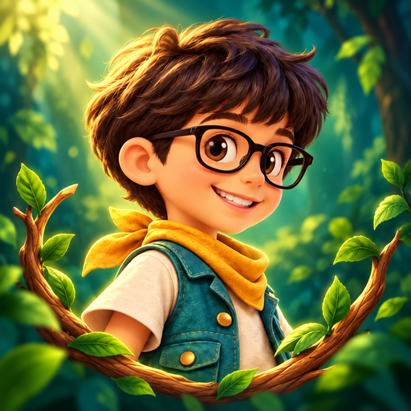

# Super Diego · nombre e icono

Desde la versión **0.5.1**, el nombre visible del juego es **Super Diego**. Sustituye a Salto Heroes en el proyecto Godot, la aplicación Android, el entrenamiento y la información de la pausa. Los instaladores se llaman `super-diego.apk` y `super-diego.exe`.

## Diseño original

El icono parte de la [referencia existente de Diego](../art/characters/diego/concept_v001.png). Conserva su rostro, gafas negras, pelo oscuro, pañuelo mostaza, chaleco verde azulado y camiseta marfil. Dos ramas forman un arco abierto, sobre un fondo del Bosque Esmeralda. No incluye letras pequeñas: el sistema presenta el nombre por separado.

Se generó con `image_gen` integrada, siguiendo la guía de personajes del proyecto. El icono es una ilustración raster para la aplicación; no sustituye las animaciones ni modifica la jugabilidad. [Prompts exactos y referencias](../art/branding/super_diego/prompts.md).

## Recursos de aplicación

| Recurso en `game/assets/branding/` | Uso |
| --- | --- |
| `super_diego_icon.png` · 512 × 512 | Icono principal de Godot |
| `super_diego_launcher.png` · 192 × 192 | Icono clásico de Android |
| `super_diego_adaptive.png` · 432 × 432 | Composición opaca de primer plano adaptativo, con más margen para máscaras |
| `super_diego_background.svg` · 432 × 432 | Fondo esmeralda del icono adaptativo |
| `super_diego.ico` · 16, 32, 48, 64, 128 y 256 px | Archivo y barra de tareas de Windows |

Los dos originales de 1254 × 1254 se conservan en `art/branding/super_diego/`, excluidos del APK. ImageMagick realiza únicamente el escalado y la conversión de formatos. La variante adaptativa se reencuadró con `image_gen`.

## Compatibilidad de datos

El identificador Android **`com.ramonc5.saltoheroes`**, el directorio de datos **`SaltoHeroes`**, los identificadores de niveles y la caché de firma de pruebas se mantienen estables. El cambio de nombre no necesita migrar el progreso ni los controles. Para actualizar la instalación anterior Android sigue requiriendo la misma firma; el nombre visible no cambia esa condición. Los skills conservan sus nombres invocables existentes.

## Verificación

Se comprueban lectura, dimensiones, opacidad, tamaños ICO, configuración y sintaxis de los scripts modificados. Se revisa el diseño a tamaño reducido y con máscara circular. Las gafas y la expresión se reconocen sin texto ni señales dependientes solo del color. [Metadatos de los recursos](../art/branding/super_diego/qa.json).

La CI importa y arranca el juego, ejecuta las regresiones existentes y comprueba `application-label:'Super Diego'` en el APK. El emulador abre los detalles de la aplicación instalada, verifica el nombre en la interfaz Android y guarda `actual_identidad.png`, además de las capturas de juego. La revisión en móviles físicos y la exportación de Windows quedan separadas de esta comprobación Android.

Referencias técnicas: [iconos de Android en Godot](https://docs.godotengine.org/en/stable/tutorials/export/exporting_for_android.html#providing-launcher-icons) e [iconos de Windows en Godot](https://docs.godotengine.org/en/stable/tutorials/export/changing_application_icon_for_windows.html).
