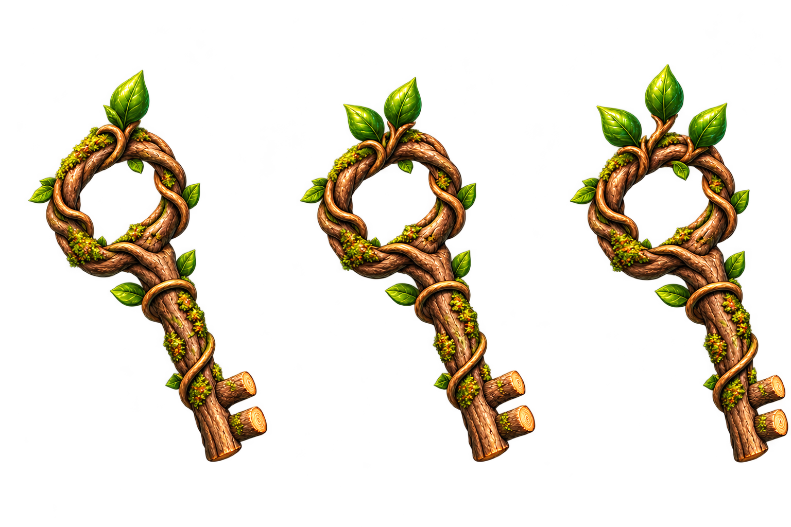
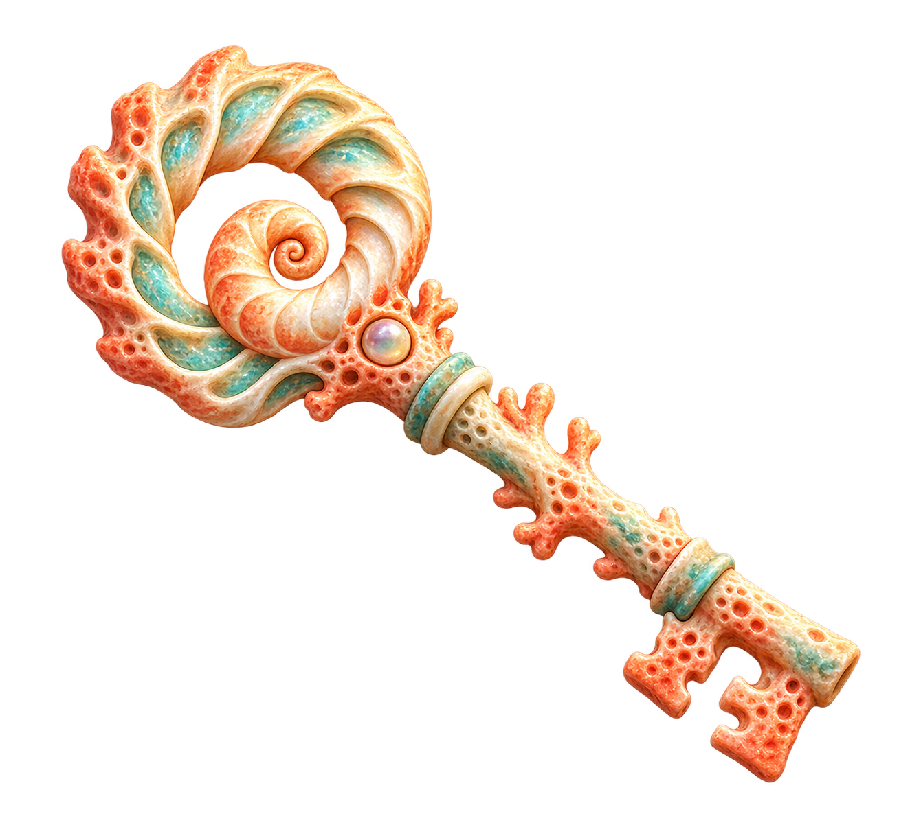
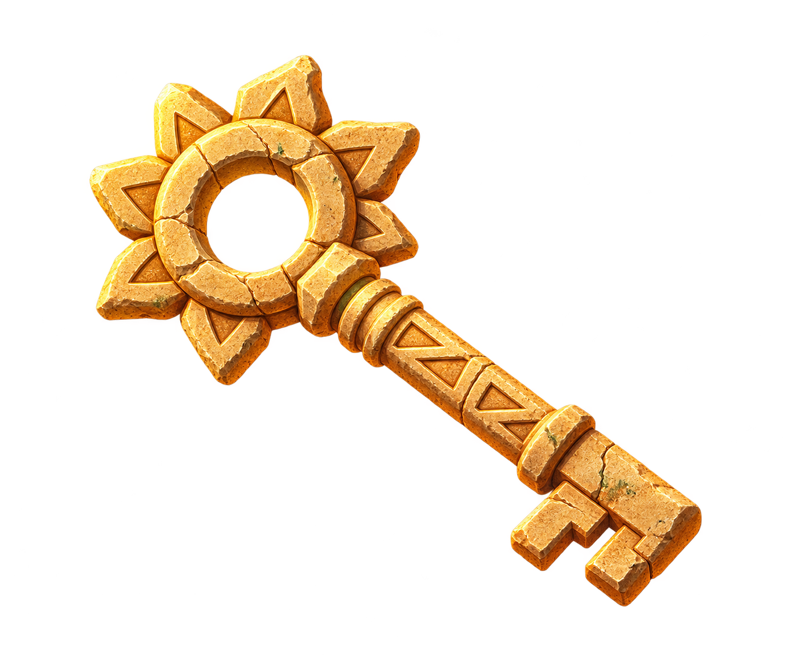
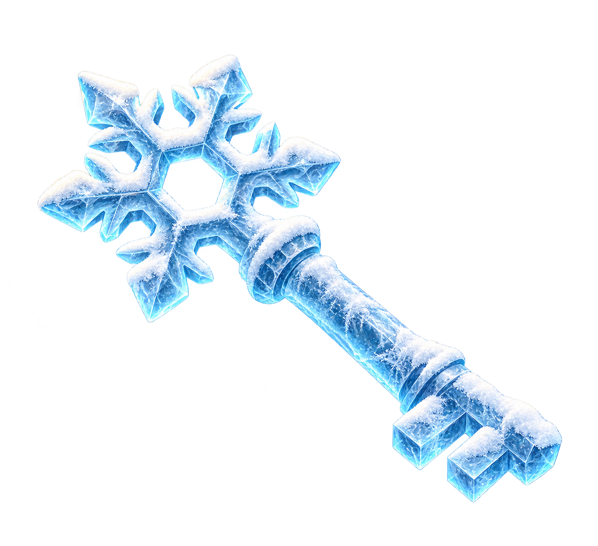
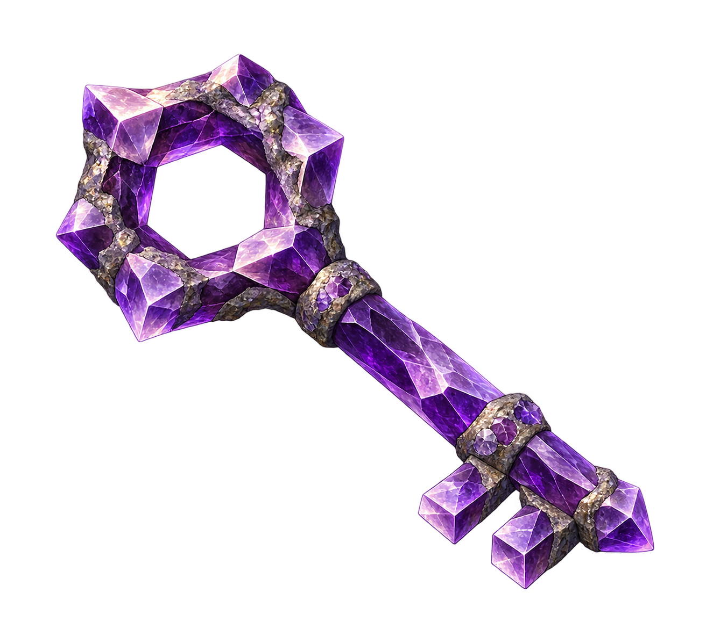
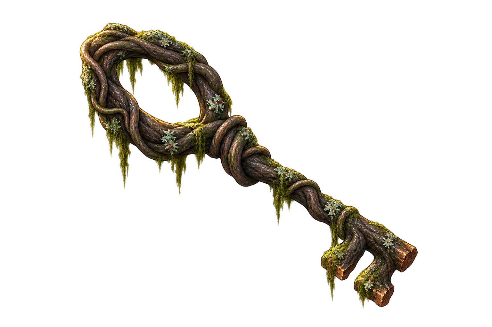
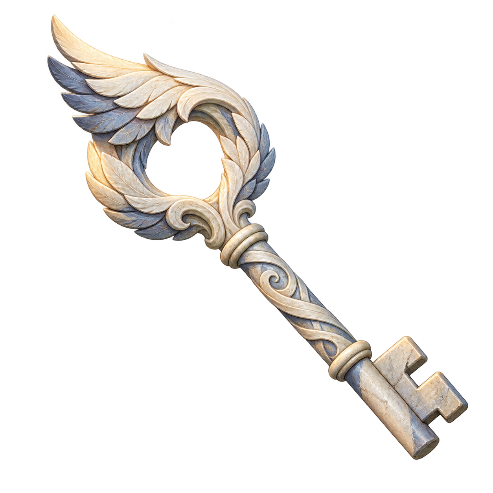
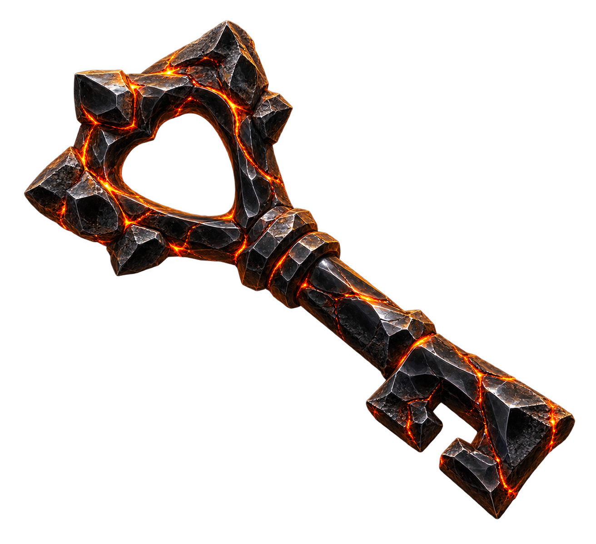
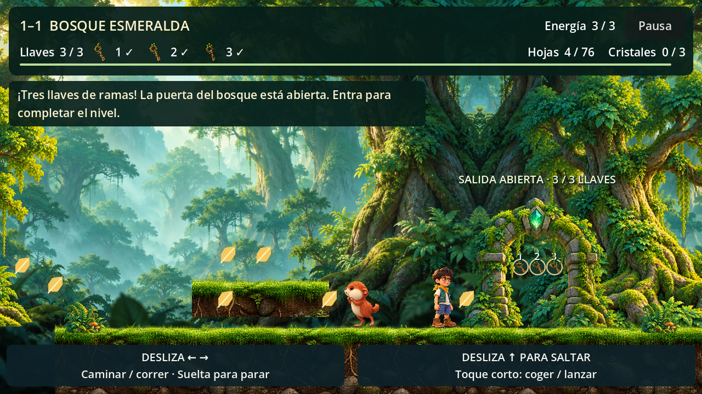

# Tres llaves para abrir la salida

Cada intento exige **tres llaves distintas** antes de atravesar la puerta de salida. Se recogen automáticamente al tocar a Diego, sin ocupar las manos ni añadir botones. Hojas y cristales siguen siendo opcionales.

El HUD muestra **Llaves 0 / 3**, tres iconos numerados y una marca ✓ por llave recogida. La puerta repite las tres ranuras y muestra su estado con texto. Con una o dos llaves, el panel de madera bloquea físicamente el paso; con las tres, se abre y entrar completa y guarda el nivel una sola vez. Si falta alguna, se puede retroceder para buscarla.

## Diseños por ambiente

Bosque Esmeralda es la temática existente y ya integrada. Las otras siete familias son propuestas para futuros tipos de nivel: **no asignan nombres ni temáticas definitivas a `world_02`–`world_08`**. El arte se elige por nivel, independientemente de su identificador de mundo.

| Ambiente | Material y silueta | Estado |
| --- | --- | --- |
| Bosque | Ramas trenzadas, corteza cálida, musgo, arco de enredadera y brotes | Integrado en 1-1 |
| Costa o arrecife | Coral melocotón, pequeña perla y cabeza de espiral marina | Propuesta |
| Desierto o ruinas | Arenisca dorada erosionada, cabeza solar y dientes escalonados | Propuesta |
| Nieve o montaña helada | Hielo azul, cabeza de copo y bordes escarchados | Propuesta |
| Cueva mineral | Amatista facetada, cabeza de geoda hexagonal y dientes prismáticos | Propuesta |
| Pantano | Raíces oscuras de manglar, líquenes y cabeza de lágrima alargada | Propuesta |
| Cielo o cumbres | Caliza clara, plumas y cabeza con forma de ala | Propuesta |
| Volcán | Obsidiana negra, cabeza triangular y grietas de brasa contenidas | Propuesta |

| Costa | Desierto | Hielo |
| --- | --- | --- |
|  |  |  |

| Cueva | Pantano | Cielo | Volcán |
| --- | --- | --- | --- |
|  |  |  |  |

La identidad depende del material y la forma, además del color. Se mantiene vista lateral, acabado raster HD, luz desde arriba a la izquierda y sombreado suave, coherentes con el arte existente. Las llaves del bosque tienen tres variantes de brotes; los números 1, 2 y 3 aseguran su identificación. Las demás familias tienen una textura reutilizable en las tres ranuras numeradas.

## Bosque Esmeralda 1-1

| Llave | Posición lógica | Propósito |
| --- | --- | --- |
| 1 | (820, 550), ruta del suelo | Enseñar la recogida en un tramo seguro |
| 2 | (3960, 466), plataforma anterior al farol | Explorar y saltar antes del punto de control |
| 3 | (6600, 466), plataforma del último tramo | Completar el requisito antes del arco |

Las plataformas se alcanzan saltando desde el suelo. No hacen falta cristales ni objetos en las manos. La recogida no cambia el combate por pisotón ni los lanzamientos; los futuros niveles con jefe deberán conservar su condición de combate junto a la puerta.

Volver al farol conserva las llaves del intento, incluso las recogidas después de activarlo; no reaparecen ni cuentan otra vez. Reiniciar o rejugar vuelve a cerrar la puerta y repone las tres llaves. Los mejores resultados y desbloqueos permanecen. La finalización añade `keys: 3`; `LevelProgress` guarda `best_keys`, compatible con resultados anteriores del esquema 1.

## Integración y accesibilidad

`LevelKeyDefinition` conserva material, textura y regiones normalizadas; sus ocho recursos están en `game/features/levels/keys/definitions/`. `LevelKey` implementa recogida única en la capa de coleccionables. `ForestStage` registra las tres ranuras y valida el requisito antes de finalizar. `KeyExitDoor` presenta los cerrojos y retira su barrera al recibir las tres ranuras distintas.

Los PNG RGBA originales están en `game/assets/textures/keys/`. Godot usa `AtlasTexture` y el tratamiento de alfa del protagonista; la colisión es independiente del dibujo. El HUD conserva proporciones, números y marcas además del color. No se añaden parpadeos ni controles táctiles.

Prompts exactos de la herramienta integrada `image_gen` y revisión técnica: `art/keys/`. Las pruebas están integradas en `tools/tests/test_forest.gd`; `capture_forest.gd` añade imágenes de llaves en plataforma, puerta cerrada y puerta abierta al artefacto habitual de Actions.

