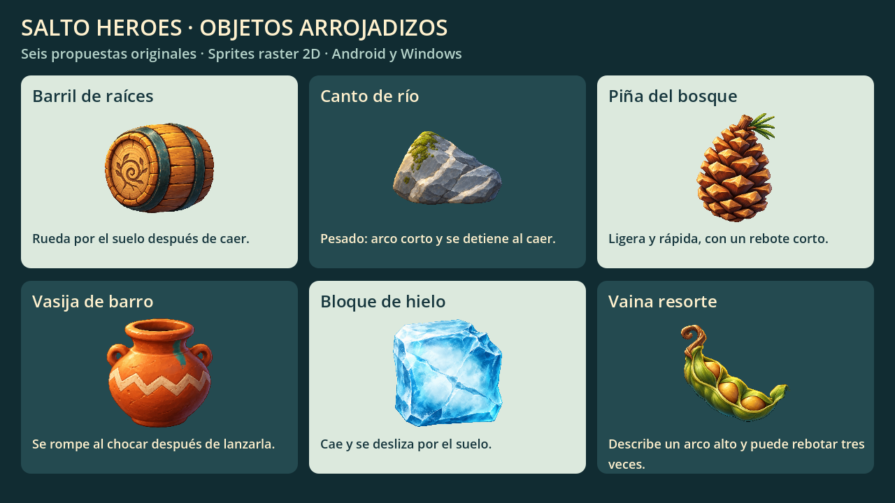

# Objetos arrojadizos de Super Diego

Seis propuestas originales integradas en el entrenamiento de Diego. Se pueden recoger, transportar y lanzar con el toque corto de acción, con **E** o con **X** del mando. La suelta sigue sincronizada con su animación.

Nombres, materiales y parámetros son propuestas de esta entrega. Los objetos son compartidos y no se han asignado a mundos. El combate con jefes y las debilidades elementales siguen pendientes.

| Objeto | Comportamiento | Ficha |
| --- | --- | --- |
| **Barril de raíces** | Rueda por el suelo después de caer. | [Ver imagen y ficha](../art/objects/barril_raices/ficha.md) |
| **Canto de río** | Pesado: arco corto y se detiene al caer. | [Ver imagen y ficha](../art/objects/canto_rio/ficha.md) |
| **Piña del bosque** | Ligera y rápida, con un rebote corto. | [Ver imagen y ficha](../art/objects/pina_bosque/ficha.md) |
| **Vasija de barro** | Se rompe al chocar después de lanzarla. | [Ver imagen y ficha](../art/objects/vasija_barro/ficha.md) |
| **Bloque de hielo** | Cae y se desliza por el suelo. | [Ver imagen y ficha](../art/objects/bloque_hielo/ficha.md) |
| **Vaina resorte** | Describe un arco alto y puede rebotar tres veces. | [Ver imagen y ficha](../art/objects/vaina_resorte/ficha.md) |

## Vista conjunta



## Integración

- Recursos finales: `game/assets/textures/objects/<id>/idle_v001.png`; importación a 256 × 256, sin mipmaps.
- Datos editables: `game/features/objects/definitions/<id>.tres`, derivados de `ThrowableDefinition`.
- Entidad reutilizable: `game/features/objects/throwable_object.tscn`; asignar una definición antes de añadirla al árbol.
- La reposición y `recovery_bounds` se configuran por nivel; ambos están desactivados por defecto en la escena reutilizable.
- Estados: libre, sostenido, lanzado y roto. `can_cause_thrown_damage()` valida estado, tiempo y velocidad.
- El receptor implementa `receive_thrown_hit(object)` y decide su vulnerabilidad. La diana prueba el contrato; no implementa todavía un jefe.
- Rotación de vuelo, rodadura, deslizamiento y compresión al rebotar se animan en tiempo de juego a partir del PNG. La vasija se oculta al romperse, sin fragmentos animados.
- En el entrenamiento, la reposición tarda tres segundos desde que se agota o rompe; recoger cancela la reposición. Salir del área devuelve el objeto a su propio puesto.
- Textos de nombre y comportamiento se muestran al llevarlo, junto con las instrucciones del control. No hay botones nuevos de juego.

## Verificación

```sh
godot --headless --path . --editor --import --quit
godot --headless --fixed-fps 60 --path . --script tools/tests/test_throwables.gd
godot --headless --fixed-fps 60 --path . --script tools/tests/test_player.gd
```

63 comprobaciones físicas de objetos y las 55 existentes del protagonista y controles. La CI ejecuta ambos grupos antes de exportar el APK. [Informe y límites de validación](../art/objects/qa.md).

