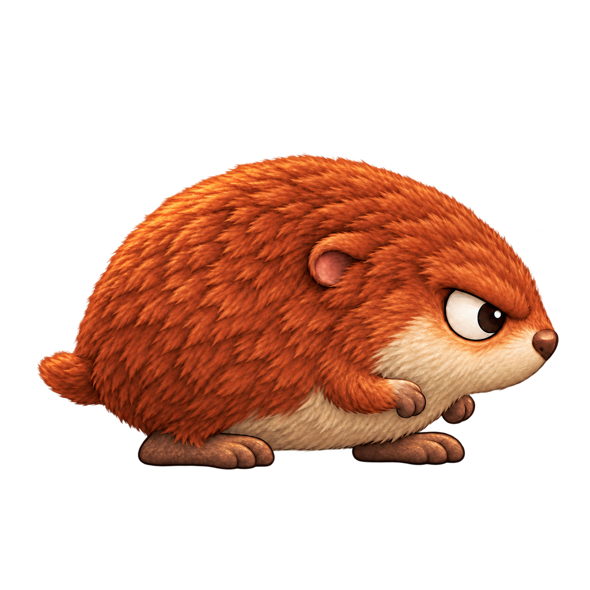
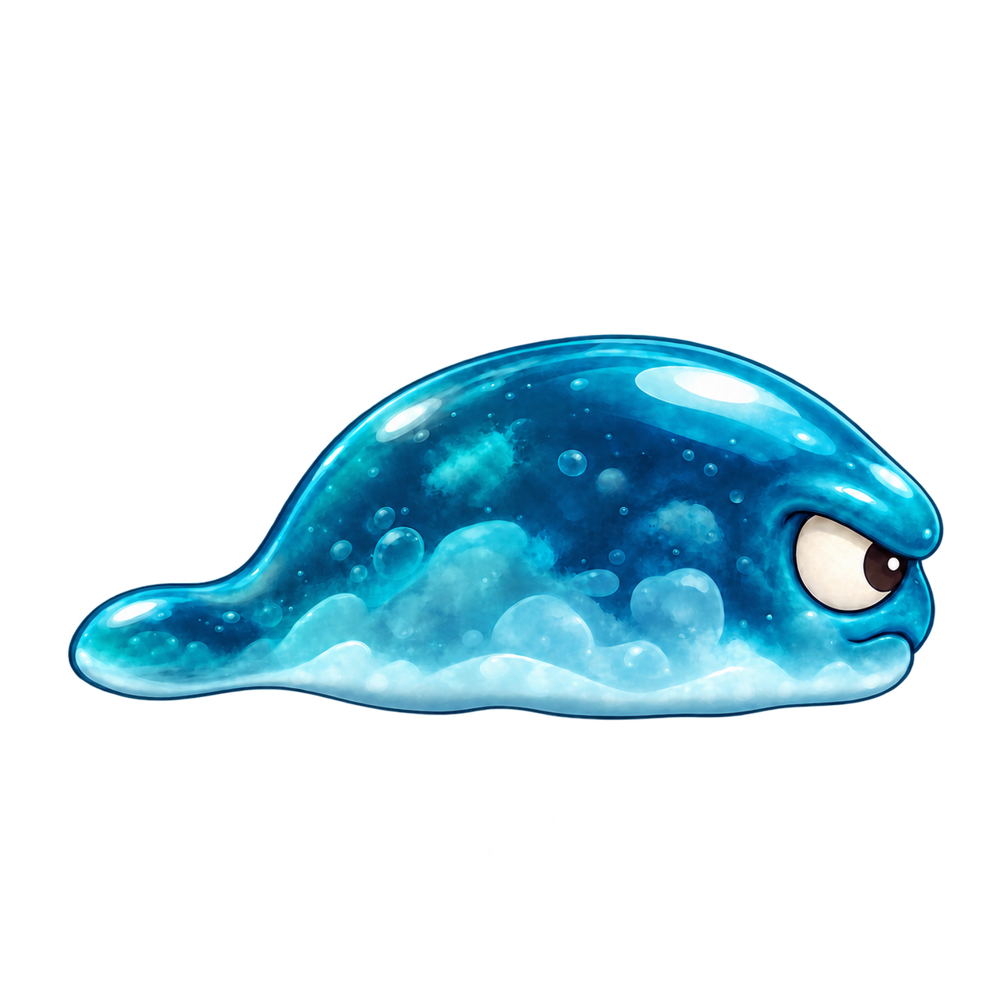
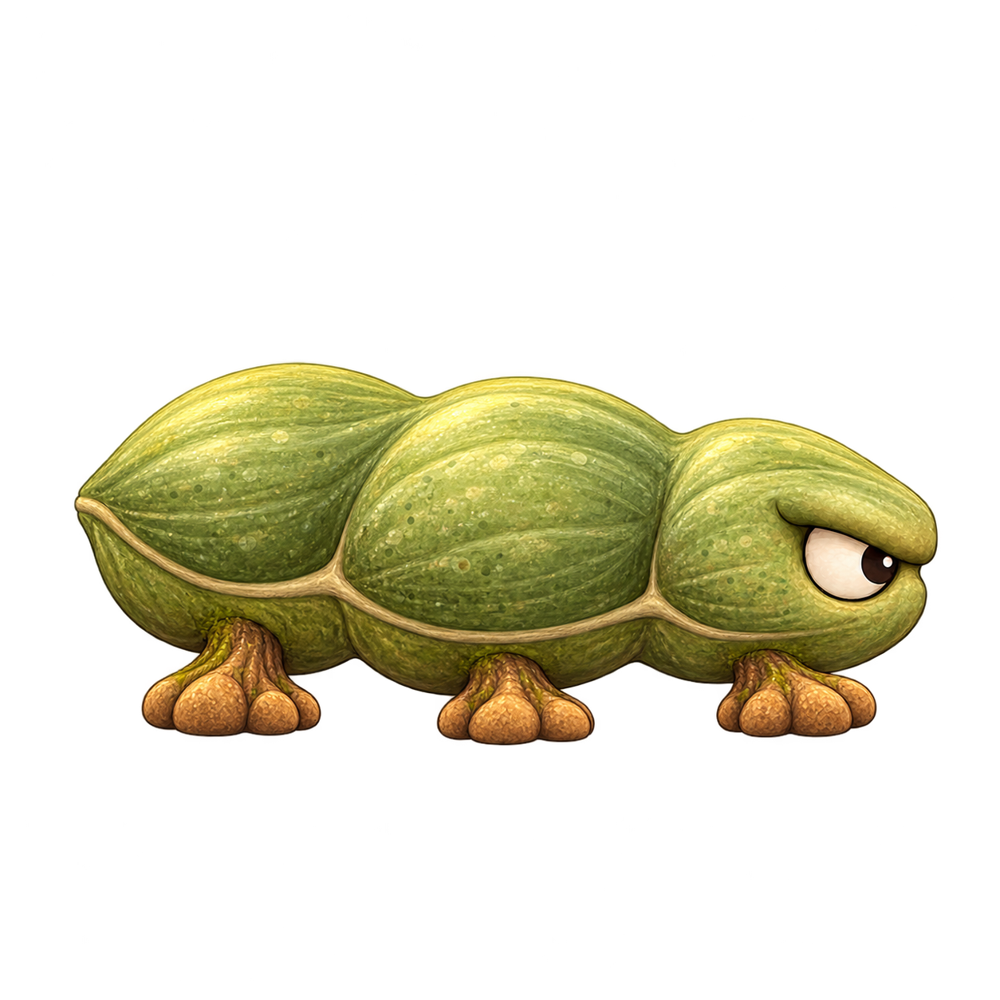
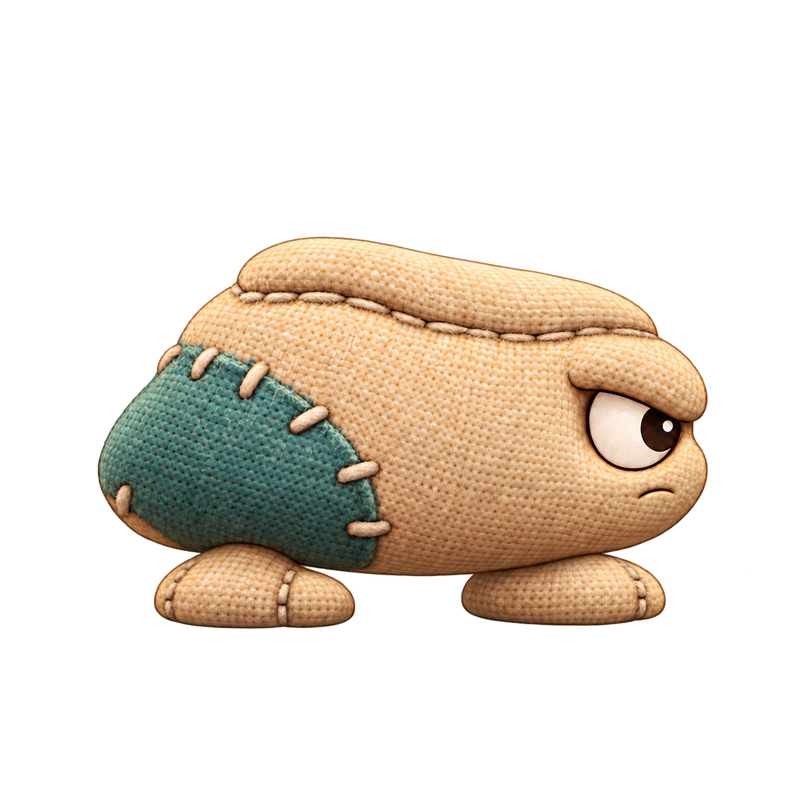

# Personajes de Salto Heroes

Catálogo vivo de los personajes diseñados para Juego Diego. Cada entrada conserva su identificador, ficha e imagen dentro del repositorio. Fecha de actualización: **15 de octubre de 2026**.

El catálogo reúne **seis enemigos normales**: Terrón y cinco propuestas adicionales. Sus imágenes y fichas son material de concepto; la animación y la integración jugable quedan pendientes.

Los estados se registran por separado: propuesta visual, recurso animado verificado e integración probada en Godot. La aprobación de un diseño corresponde al usuario.

| ID estable | Nombre propuesto | Rol | Mundos | Diseño | Producción |
| --- | --- | --- | --- | --- | --- |
| `terron` | [Terrón](../art/characters/terron/ficha.md) | Primer enemigo normal, eliminable por pisotón | Sin asignar | Propuesto | Concepto PNG; animación e integración pendientes |
| `moflete` | [Moflete](../art/characters/moflete/ficha.md) | Enemigo normal, eliminable por pisotón | Sin asignar | Propuesto | Concepto PNG; animación e integración pendientes |
| `goteron` | [Goterón](../art/characters/goteron/ficha.md) | Enemigo normal, eliminable por pisotón | Sin asignar | Propuesto | Concepto PNG; animación e integración pendientes |
| `vainete` | [Vainete](../art/characters/vainete/ficha.md) | Enemigo normal, eliminable por pisotón | Sin asignar | Propuesto | Concepto PNG; animación e integración pendientes |
| `plumin` | [Plumín](../art/characters/plumin/ficha.md) | Enemigo normal, eliminable por pisotón | Sin asignar | Propuesto | Concepto PNG; animación e integración pendientes |
| `remiendo` | [Remiendo](../art/characters/remiendo/ficha.md) | Enemigo normal, eliminable por pisotón | Sin asignar | Propuesto | Concepto PNG; animación e integración pendientes |

## Terrón · primer enemigo normal

Criatura baja y ancha de tierra ocre, cubierta por musgo blando y apoyada sobre dos pies de raíz. La vista lateral, el ojo claro y la parte superior despejada facilitan reconocer su dirección y la zona sobre la que saltar. Su comportamiento propuesto es una patrulla terrestre sencilla.

- [Ficha de diseño y comportamiento](../art/characters/terron/ficha.md).
- [Imagen de concepto seleccionada para esta entrega](../art/characters/terron/concept_v002.png).
- [Metadatos y estado de producción](../art/characters/terron/character.json).
- [Prompts exactos y procedencia](../art/characters/terron/prompts.md).
- [Revisión técnica y visual](../art/characters/terron/qa.md).

El nombre, especie, materiales y aspecto son una propuesta original. La especificación completa de la elección artística previa «opción A» sigue pendiente de incorporarse. Se conservan los requisitos conocidos de imagen 2D de acabado pulido, Android y Windows, ocho mundos y niveles rejugables.

## Moflete · enemigo normal

Criatura de pelaje compacto. Óvalo corto y abombado, hocico redondeado y dos orejas pequeñas pegadas a los lados. Patrulla con pasos cortos y pausas de olfateo. Reacción al pisotón propuesta: el cuerpo se comprime y el hocico baja al recibir el pisotón.

- [Ficha e identidad visual](../art/characters/moflete/ficha.md).
- [Imagen de concepto](../art/characters/moflete/concept_v003.png).
- [Metadatos](../art/characters/moflete/character.json), [prompts exactos](../art/characters/moflete/prompts.md) y [revisión](../art/characters/moflete/qa.md).

## Goterón · enemigo normal

Criatura blanda de gel. Cuerpo alargado y bajo, con frente redondeado y cola corta que descansa cerca del suelo. Deslizamiento continuo y lento, con giro suave en los extremos de su patrulla. Reacción al pisotón propuesta: se aplana de forma breve antes de desaparecer; reacción visual pendiente de animar.

- [Ficha e identidad visual](../art/characters/goteron/ficha.md).
- [Imagen de concepto](../art/characters/goteron/concept_v003.png).
- [Metadatos](../art/characters/goteron/character.json), [prompts exactos](../art/characters/goteron/prompts.md) y [revisión](../art/characters/goteron/qa.md).

## Vainete · enemigo normal

Criatura de vaina vegetal. Vaina horizontal con tres abultamientos suaves y patas cortas de raíz. Patrulla constante de seis apoyos, con una pausa breve antes de cambiar de dirección. Reacción al pisotón propuesta: los tres segmentos se comprimen juntos para comunicar una única derrota.

- [Ficha e identidad visual](../art/characters/vainete/ficha.md).
- [Imagen de concepto](../art/characters/vainete/concept_v001.png).
- [Metadatos](../art/characters/vainete/character.json), [prompts exactos](../art/characters/vainete/prompts.md) y [revisión](../art/characters/vainete/qa.md).

## Plumín · enemigo normal

Ave terrestre redondeada. Cuerpo de pera compacto, cabeza redondeada y dos pies anchos. Alterna dos pasos cortos con un pequeño salto; ritmo y altura pendientes de ajustar. Reacción al pisotón propuesta: se encoge, pliega las alas y baja la cabeza como señal de derrota.

- [Ficha e identidad visual](../art/characters/plumin/ficha.md).
- [Imagen de concepto](../art/characters/plumin/concept_v002.png).
- [Metadatos](../art/characters/plumin/character.json), [prompts exactos](../art/characters/plumin/prompts.md) y [revisión](../art/characters/plumin/qa.md).

## Remiendo · enemigo normal

Criatura de tela acolchada. Trapecio blando de hombros redondeados, parte superior baja y dos pies planos de tela. Da pasos rápidos durante una distancia corta y se detiene de forma visible antes de repetir. Reacción al pisotón propuesta: la tela se pliega y el volumen se aplasta de forma clara, sin violencia gráfica.

- [Ficha e identidad visual](../art/characters/remiendo/ficha.md).
- [Imagen de concepto](../art/characters/remiendo/concept_v003.png).
- [Metadatos](../art/characters/remiendo/character.json), [prompts exactos](../art/characters/remiendo/prompts.md) y [revisión](../art/characters/remiendo/qa.md).

## Cómo mantener el catálogo

Añadir una fila por identificador y una ficha en `art/characters/<character_id>/ficha.md`, acompañada por su imagen real, encargo, prompts, metadatos y revisión. Versionar cambios visuales sin reemplazar referencias anteriores. Guardar únicamente recursos de juego preparados en `game/assets/textures/characters/<character_id>/` cuando se encargue esa producción.

