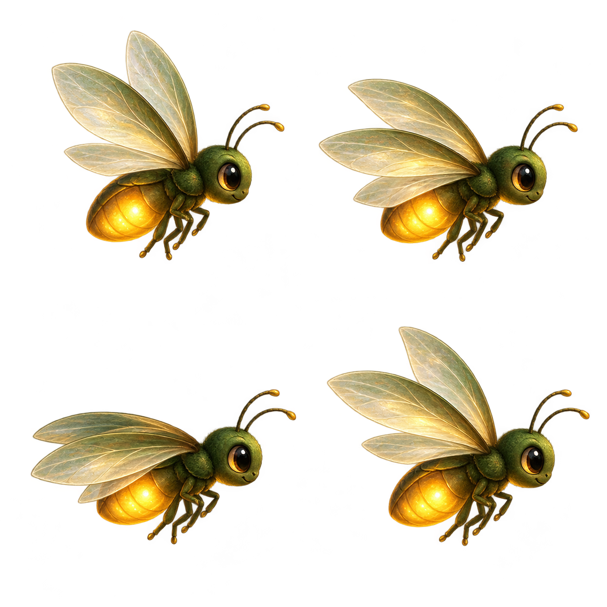
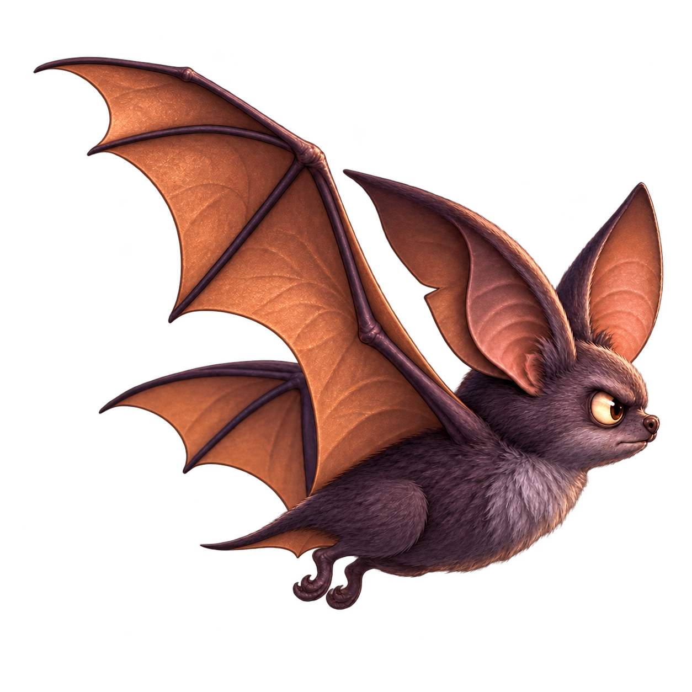

# Personajes de Super Diego

Catálogo del **protagonista Diego y los siete enemigos normales** de Juego Diego. Fecha de actualización: **17 de octubre de 2026**.

El usuario valoró los seis conceptos anteriores y pidió diferenciar sus personalidades. Terrón, Moflete y Nóctilo tienen integración jugable; los otros cuatro conservan su estado de concepto. Se añade **Nóctilo**, un enemigo volador tipo murciélago, con diseño propuesto. Diego se ha creado a partir de la fotografía del usuario y tiene una primera integración jugable con animaciones y controles.

## Animación del reparto · 0.5.3

Los siete diseños tienen movimiento local del raster por malla 2D: brazos y manos donde existen, raíces y gel según su anatomía, ala plegada de Plumín y aleteo armónico de Nóctilo con flexión desfasada de las puntas. Terrón y Moflete lo reproducen en el bosque. Nóctilo vuela con rutas fijas en Bosque 1-2 desde 0.14.0; los otros cuatro tienen integración visual en el visor. No se han creado hojas nuevas. [Técnica, visor y pruebas](ANIMACION_ENEMIGOS.md).

## Ayudante del bosque · Luci (0.8.0)

| Personaje | ID | Rol y mundos | Estado |
| --- | --- | --- | --- |
| [Luci](../art/characters/luci/ficha.md) | `luci` | Acompañante opcional; `world_01` | Diseño propuesto integrado, cuatro poses de aleteo y desbloqueo persistente |

Se despierta con tres fragmentos, acompaña a Diego, señala la entrada secreta y recoge hojas próximas sin atravesar paredes. Puede descansar desde Colección. [Ficha](../art/characters/luci/ficha.md), [prompts](../art/characters/luci/prompts.md), [metadatos](../art/characters/luci/character.json) y [revisión](../art/characters/luci/qa.md). Las prendas de Diego reutilizan sus poses con material propio y tejido raster; [vestuario y recompensas](RECOMPENSAS.md).

## Protagonista Diego

La entrada 0.11.0 añade [ocho poses de carrera](../game/assets/textures/characters/diego/intro_run_v001.png) para Diego y reutiliza a Moflete y Nóctilo como actores articulados de la presentación. Esta aparición decorativa de Nóctilo no añade combate en el nivel. [Ficha de Diego](../art/characters/diego/ficha.md) · [Procedencia](../art/entrance/prompts-0.11.0.md) · [Validación](pruebas/entrada-0.11.0.md).

| Personaje | ID | Rol y mundos | Estado |
| --- | --- | --- | --- |
| [Diego](../art/characters/diego/ficha.md) | `diego` | Protagonista compartido; sin mundo exclusivo | Diseño propuesto; 48 poses, 14 estados (incluido agacharse) y controles comprobados en Godot |

- [Ficha e imagen](../art/characters/diego/ficha.md), [movimientos y controles](PROTAGONISTA.md).
- [Prompts](../art/characters/diego/prompts.md), [metadatos](../art/characters/diego/character.json) y [revisión](../art/characters/diego/qa.md).
- [Entrenamiento con controles táctiles](../art/characters/diego/preview_gameplay.png) y [opciones](../art/characters/diego/preview_controls.png).

Nombre y vestuario propuestos; se conservan pelo, gafas y rasgos de la referencia. Quedan las pruebas físicas en Android y tablet Windows y la ficha detallada de «opción A».

## Comparación de identidades

| Personaje | Concepto conservado | Personalidad | Silueta | Rostro y gesto |
| --- | --- | --- | --- | --- |
| [Terrón](../art/characters/terron/ficha.md) | Tierra y musgo | dormilón, pesado, testarudo | Cuerpo muy bajo y horizontal, con mayor masa en el lomo trasero y frente hundida. | Ojo ámbar entrecerrado, casi sin blanco, y boca encogida bajo una mejilla pesada. |
| [Moflete](../art/characters/moflete/ficha.md) | Roedor cobrizo | curioso, glotón, inquieto | Roedor erguido de tronco estrecho, mejilla desproporcionada y cola curvada. | Ojo oscuro redondo sin blanco, nariz pequeña y boca abierta de sorpresa. |
| [Goterón](../art/characters/goteron/ficha.md) | Gel turquesa deslizante | despistado, bonachón, desequilibrado | Base de babosa larga y baja con un cuello blando que sube y se vence hacia delante. | Dos ojitos oscuros pequeños y desiguales sobre el lado visible del gel, y sonrisa blanda. |
| [Vainete](../art/characters/vainete/ficha.md) | Vaina vegetal de tres volúmenes | disciplinado, orgulloso, meticuloso | Vaina muy alargada de tres volúmenes suaves y seis raíces finas. | Ojo verde pequeño y almendrado, y dos fibras vegetales caídas como bigote. |
| [Plumín](../art/characters/plumin/ficha.md) | Ave terrestre azul | presumido, fanfarrón, teatral | Pecho amplio, cuello visible y dos patas relativamente largas y delgadas. | Ojo cerrado en arco satisfecho y pico curvo alzado. |
| [Remiendo](../art/characters/remiendo/ficha.md) | Criatura de tela remendada | tímido, torpe, desgarbado | Muñeco de tela alto y ladeado, un hombro más bajo, brazos blandos y pies desiguales. | Botón oscuro pequeño como ojo visible y boca bordada corta y encogida. |
| [Nóctilo](../art/characters/noctilo/ficha.md) | Murciélago volador nuevo | desconfiado, nervioso, sigiloso | Cuerpo suspendido y afinado, alas membranosas angulosas, orejas grandes y patas recogidas. | Mirada ámbar oblicua, hocico corto y orejas orientadas en dos direcciones. |

Compartir texturas, luz y acabado mantiene la coherencia artística. La identidad se diferencia también sin depender del color, mediante el contorno, la cara y la actuación. Los mundos siguen sin asignar; se mantienen los ocho mundos, los niveles rejugables y Android y Windows. La especificación completa de «opción A» sigue pendiente de incorporarse.

## Terrón · dormilón, pesado, testarudo

El que tarda en arrancar y después sigue a lo suyo. Cuerpo muy bajo y horizontal, con mayor masa en el lomo trasero y frente hundida. Peso hundido entre dos apoyos de raíz ensanchados y mentón bajo.

- [Ficha, personalidad y comportamiento](../art/characters/terron/ficha.md).
- [Nueva imagen de concepto](../art/characters/terron/concept_v003.png) y [versión anterior](../art/characters/terron/concept_v002.png).
- [Metadatos](../art/characters/terron/character.json), [prompts](../art/characters/terron/prompts.md) y [revisión](../art/characters/terron/qa.md).

## Moflete · curioso, glotón, inquieto

Primero olfatea; después descubre que iba demasiado deprisa. Roedor erguido de tronco estrecho, mejilla desproporcionada y cola curvada. Dos patas traseras alargadas en puntillas y manos pequeñas cerca de las mejillas.

- [Ficha, personalidad y comportamiento](../art/characters/moflete/ficha.md).
- [Nueva imagen de concepto](../art/characters/moflete/concept_v004.png) y [versión anterior](../art/characters/moflete/concept_v003.png).
- [Metadatos](../art/characters/moflete/character.json), [prompts](../art/characters/moflete/prompts.md) y [revisión](../art/characters/moflete/qa.md).

## Goterón · despistado, bonachón, desequilibrado

Su cuerpo ya ha girado cuando se da cuenta de por dónde iba. Base de babosa larga y baja con un cuello blando que sube y se vence hacia delante. Cabeza redondeada caída hacia delante; base continua y cola pegada al suelo.

- [Ficha, personalidad y comportamiento](../art/characters/goteron/ficha.md).
- [Nueva imagen de concepto](../art/characters/goteron/concept_v004.png) y [versión anterior](../art/characters/goteron/concept_v003.png).
- [Metadatos](../art/characters/goteron/character.json), [prompts](../art/characters/goteron/prompts.md) y [revisión](../art/characters/goteron/qa.md).

## Vainete · disciplinado, orgulloso, meticuloso

Marca el paso aunque nadie lo esté siguiendo. Vaina muy alargada de tres volúmenes suaves y seis raíces finas. Cuerpo horizontal recto; una raíz delantera levantada en un paso medido.

- [Ficha, personalidad y comportamiento](../art/characters/vainete/ficha.md).
- [Nueva imagen de concepto](../art/characters/vainete/concept_v002.png) y [versión anterior](../art/characters/vainete/concept_v001.png).
- [Metadatos](../art/characters/vainete/character.json), [prompts](../art/characters/vainete/prompts.md) y [revisión](../art/characters/vainete/qa.md).

## Plumín · presumido, fanfarrón, teatral

Se pavonea incluso cuando tiene que dar un rodeo. Pecho amplio, cuello visible y dos patas relativamente largas y delgadas. Pecho hacia delante, una rodilla levantada y ala pequeña apoyada en el costado.

- [Ficha, personalidad y comportamiento](../art/characters/plumin/ficha.md).
- [Nueva imagen de concepto](../art/characters/plumin/concept_v003.png) y [versión anterior](../art/characters/plumin/concept_v002.png).
- [Metadatos](../art/characters/plumin/character.json), [prompts](../art/characters/plumin/prompts.md) y [revisión](../art/characters/plumin/qa.md).

## Remiendo · tímido, torpe, desgarbado

Intenta ocupar poco espacio, pero siempre deja un pie por medio. Muñeco de tela alto y ladeado, un hombro más bajo, brazos blandos y pies desiguales. Hombros caídos; una mano de tela sujeta el otro antebrazo y un pie grande apunta hacia dentro.

- [Ficha, personalidad y comportamiento](../art/characters/remiendo/ficha.md).
- [Nueva imagen de concepto](../art/characters/remiendo/concept_v004.png) y [versión anterior](../art/characters/remiendo/concept_v003.png).
- [Metadatos](../art/characters/remiendo/character.json), [prompts](../art/characters/remiendo/prompts.md) y [revisión](../art/characters/remiendo/qa.md).

## Nóctilo · desconfiado, nervioso, sigiloso

| Personaje | ID | Rol y mundos | Estado |
| --- | --- | --- | --- |
| [Nóctilo](../art/characters/noctilo/ficha.md) | `noctilo` | Enemigo normal volador; sin mundo exclusivo | Diseño propuesto, raster articulado y vuelo jugable sin persecución en Bosque 1-2 · 0.14.0 |

Vigila todos los ruidos, incluido su propio eco. El cuerpo suspendido, las alas angulosas con membrana cobriza y las orejas largas lo distinguen del ave terrestre Plumín y del resto del reparto.

La patrulla aérea baja, la escucha y el picado con aviso por postura son propuestas de comportamiento. Se mantiene la derrota por pisotón desde arriba. Es una imagen estática: el vuelo, las colisiones y las animaciones aún no están implementados.

- [Ficha e identidad](../art/characters/noctilo/ficha.md).
- [Imagen final](../art/characters/noctilo/concept_v002.png), [encargo](../art/characters/noctilo/brief.yaml) y [metadatos](../art/characters/noctilo/character.json).
- [Prompts y referencias](../art/characters/noctilo/prompts.md), [revisión visual](../art/characters/noctilo/qa.md) e [informe técnico](../art/characters/noctilo/qa-technical.json).

## Cómo mantener el catálogo

Mantener un ID estable por personaje. Guardar ficha, PNG versionado, encargo, prompts, metadatos y revisión en `art/characters/<character_id>/`, conservando las imágenes anteriores. Registrar por separado la aceptación del concepto base y la valoración de cada nueva revisión visual. Comparar el conjunto al diseñar variantes para evitar repetir por defecto cara, proporciones y postura.

Guardar únicamente los recursos de juego preparados en `game/assets/textures/characters/<character_id>/` cuando se encargue su producción. El material de autoría permanece bajo `art/.gdignore`.

## Integración del primer nivel · 0.2.0

**Terrón y Moflete** ya aparecen como enemigos jugables de Bosque Esmeralda 1-1: siete patrullas entre ambos. Se reutilizan los conceptos raster existentes, con animación por transformación de patrulla y aplastamiento. Se eliminan por pisotón y admiten el contrato de objetos lanzados. Las hojas de fotogramas propias de estos enemigos siguen pendientes; Nóctilo se integra en Bosque 1-2 desde 0.14.0; los otros cuatro enemigos continúan como conceptos. Los metadatos y fichas de Terrón y Moflete registran esta integración.

## Movimiento revisado · 0.7.2

Terrón y Moflete avanzan y frenan progresivamente, sincronizan su zancada con el desplazamiento y alternan apoyo plano y recuperación en arco. Las manos acompañan a los brazos con menor traslación, sin deformar la proporción del cuerpo. Los siete perfiles conservan el PNG, pausa, espejo y anatomía; cinco mantienen su alcance de visor. [Detalles y verificación](ANIMACION_ENEMIGOS.md#marcha-natural-y-anatomía-estable--072).

### Diego: doble salto y lianas (0.7.3)

Nueva [pose de agarre con ambas manos](../art/characters/diego/vine_hang_source_v001.png), con texto alternativo y parámetros en [su ficha](../art/characters/diego/ficha.md). `vine_hang` fija las manos al nudo mientras se balancea; `double_jump` reinicia la animación de impulso. El conjunto suma 49 poses fuente y 16 estados.

