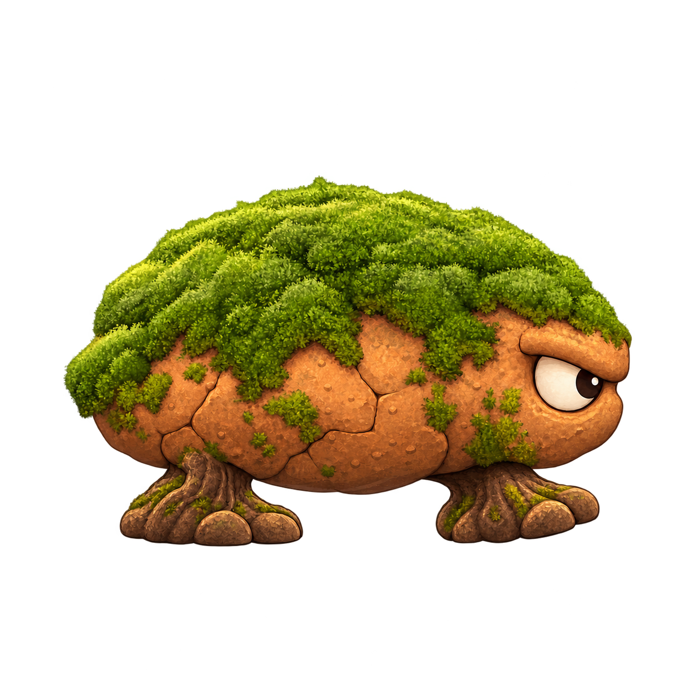

# Personajes de Salto Heroes

Catálogo vivo de los personajes diseñados para Juego Diego. Cada entrada conserva su identificador, ficha e imagen dentro del repositorio. Fecha de actualización: **15 de octubre de 2026**.

Los estados se registran por separado: propuesta visual, recurso animado verificado e integración probada en Godot. La aprobación de un diseño corresponde al usuario.

| ID estable | Nombre propuesto | Rol | Mundos | Diseño | Producción |
| --- | --- | --- | --- | --- | --- |
| `terron` | [Terrón](../art/characters/terron/ficha.md) | Primer enemigo normal, eliminable por pisotón | Sin asignar | Propuesto | Concepto PNG; animación e integración pendientes |

## Terrón · primer enemigo normal

Criatura baja y ancha de tierra ocre, cubierta por musgo blando y apoyada sobre dos pies de raíz. La vista lateral, el ojo claro y la parte superior despejada facilitan reconocer su dirección y la zona sobre la que saltar. Su comportamiento propuesto es una patrulla terrestre sencilla.

- [Ficha de diseño y comportamiento](../art/characters/terron/ficha.md).
- [Imagen de concepto seleccionada para esta entrega](../art/characters/terron/concept_v002.png).
- [Metadatos y estado de producción](../art/characters/terron/character.json).
- [Prompts exactos y procedencia](../art/characters/terron/prompts.md).
- [Revisión técnica y visual](../art/characters/terron/qa.md).

El nombre, especie, materiales y aspecto son una propuesta original. La especificación completa de la elección artística previa «opción A» sigue pendiente de incorporarse. Se conservan los requisitos conocidos de imagen 2D de acabado pulido, Android y Windows, ocho mundos y niveles rejugables.

## Cómo mantener el catálogo

Añadir una fila por identificador y una ficha en `art/characters/<character_id>/ficha.md`, acompañada por su imagen real, encargo, prompts, metadatos y revisión. Versionar cambios visuales sin reemplazar referencias anteriores. Guardar únicamente recursos de juego preparados en `game/assets/textures/characters/<character_id>/` cuando se encargue esa producción.

